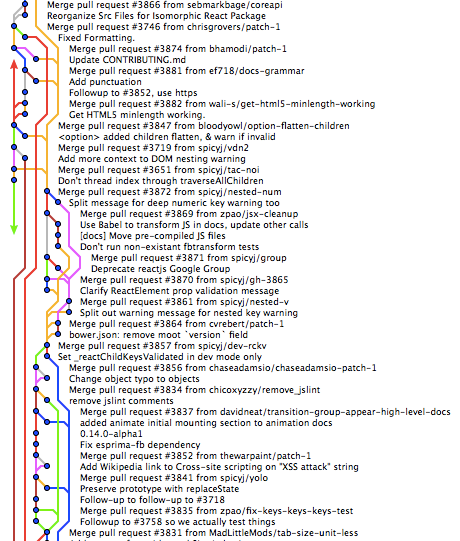
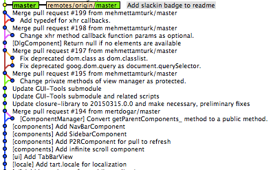
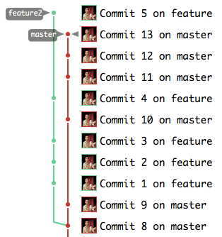
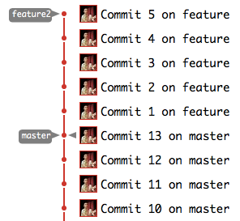
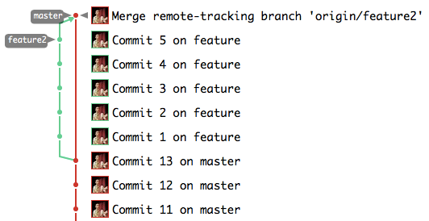
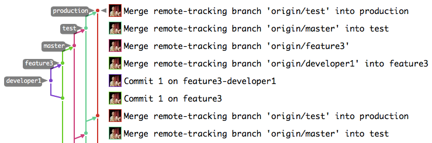

**TL;DR: Always rebase before merging changes (e.g. a pull request).**

Git is at the center of the lives of a lot of developers. We use Git for open source projects on GitHub, for private projects, for corporate projects, for creative writing or even maintaining blog posts. Git has such a wonderful architecture that it is as suitable for a large team of people as it is suitable for a one man army. It is easy to set up, easy to carry around, easy to migrate…

Yet the simple mechanisms of Git are extremely unopinionated about how a developer should use Git. Thus, a lot of people use Git in different — and potentially harmful — ways. There is the [Git Flow](http://nvie.com/posts/a-successful-git-branching-model/), and then there are people who find it [harmful](http://endoflineblog.com/gitflow-considered-harmful). It looks like the industry is still struggling with the correct usage of Git.

In this article, I am going to present yet another approach for working with Git. Hopefully, it will be helpful for other teams, too. This approach is based on simple problems and two misconceptions about Git.

### Problems

1. Working with a large team on a project is prone to errors in version control and history.
2. History becomes a worthless mess.
3. Solving merge conflicts doesn’t really solve the problem. It’s more like a workaround to get your code to the remote repository.

### Misconceptions

1. Rewriting history is a bad idea.
2. Force push is a bad idea.

## A typical Git history view



This is a typical Git commits history. I am not nitpicking, I just picked one of the hottest repos on GitHub, [React](https://github.com/facebook/react). But this snapshot is almost the same (or even worse) in any other repository with a large team of, often, independent developers.

What is the problem with this graph? Well a history graph should reflect development history and be actually meaningful. Can you decipher which commit comes after the other, and what change affects what other change here? I can’t. See the red and green arrows? Apparently **gitk** also has a problem with this, it can’t even show the whole history.

## The philosophy

One of the most prominent features of Git is its commit history. It should be readable, traversable, and flexible enough to operate on. Losing history is on par with using no version control at all.

Humans perceive time as a one-dimensional phenomenon. We schedule and arrange our future life on a linear scale. Our past is full of events pinpointed on that linear scale. So it is very easy for us to understand a linear timeline. Furthermore, our perception of time is atomic. No two events can occur at the same time. Git reflects this phenomenon too, each commit has a unique place in the history and no two commits can be made in the exactly same moment. One always has to come after the other.

If this is the case, then why are we looking for other “solutions” to clobber our workflow? Why don’t we take inspiration from life itself?



Here is an example from an [admittedly tiny repository](https://github.com/tart/tartjs) with respect to React.

But it is useful to illustrate the approach I propose. Which one do you think is more understandable and readable?

<blockquote class="pull">

History is best experienced when it’s linear.

</blockquote>

## The workflow

I follow the basic principles of [Git flow](http://nvie.com/posts/a-successful-git-branching-model/), with a twist for a linear history.

The **master** branch is the default, so it should be as *ready-to-go-live* as possible. Use a **test** branch for tracking changes to the test environment, and a **production** branch for tracking changes to the live environment. Additionally, you may want to have a **staging** branch as well. As an alternative approach, you can use tags for these environment instead of branches. Use whatever suits you best.

Use separate branches for each new feature. Developers should almost always work on these branches.

Use separate branches for bug fixes, named after the issue ID.

<blockquote class="pull">

Make sure you *never* produce *any* merge commits other than when you are accepting a pull request, or going from **master** to **test** and **test** to **production**.

</blockquote>

If there will be a merge commit, for example, when two developers are working on a feature branch and want to integrate code, make sure the late comer does a **git pull --rebase** in order to avoid that merge commit.

<blockquote class="pull">

In fact, whenever you are doing a **git pull**, always use the rebasing option.

</blockquote>

To make it the default option, use:

```bash
$ git config --global pull.rebase true
```

So far so good. Where is the catch? The catch is when you want to merge a feature branch back into **master**. Normally, a feature development would span considerable time and during that period both the feature branch and the **master** branch will receive commits. This is a common sight:



Now, this is what happens historically. Time is linear and we see that commit 10 on the **master** branch is done after commit 3 on the **feature2** branch, etc.

However, this order is not really meaningful after the feature branch is merged. Commits on **master** and **feature2** branches are most probably separate works, their relative order doesn’t provide any useful information.

New commits on the **master** branch may have code that would interfere with the code from the **feature2** branch. If that is the case, a merge conflict could occur when we try to merge it back into **master**. And typically you would solve all the problems that occurred during multiple commits in a *single* merge commit. And you would lose the context of what those fixes in that merge commit are related to. How catastrophic.

<blockquote class="pull">

The core idea is that, feature branches should be treated as single commits when they are being merged to **master**.

</blockquote>

Why? Because from the point of view of the **master** branch, the feature branch is *irrelevant*. It doesn’t even exist. It doesn’t really matter when the feature was *developed*. It only matters when it will be *merged*. So why don’t we treat the feature branch as being developed right after the last commit on **master**? Yes, I’m talking about rebasing the feature branch onto the **master** branch, via something like;

```bash
$ git checkout feature2
```

```text
Switched to branch ‘feature2’
Your branch is up-to-date with ‘origin/feature2’.
```

```bash
$ git pull --rebase origin master
```

```text
From ssh://github.com/somegitrepo
 * branch            master     -> FETCH_HEAD
First, rewinding head to replay your work on top of it...
Applying: Commit 1 on feature
Applying: Commit 2 on feature
Applying: Commit 3 on feature
Applying: Commit 4 on feature
Applying: Commit 5 on feature
```

This puts the feature branch on the tip of **master**, as if we just branched off and did all the commits at once. Now this is known as rewriting history, which is — mistakenly — regarded as evil, but from the point of the **master** branch, it’s not very important since the feature branch never even existed. True, rewriting some histories are a bad idea. But it’s not all black and white, there are some places where it is very useful.



Now the history looks like this. Pretty, pretty sweet.

Now is the time for a pull request. But first you should send this code to the remote repository. If you just do a **git push**, it will fail. Because although the remote branch contains mostly the same commits, their orders and parents are different. So you have to do a force push. It is another misconception about Git and many people will tell you that force pushing is a bad idea. It is not *always* a bad idea. Not only that but it is part of a normal workflow for feature and development branches. Of course, you would only force push to **master**, **test** and **production** in case of an emergency or a mistake. The less the better. But feature and development branches are exempt from this rule.

If you do accept this pull request on GitHub or GitLab, they will automatically create a merge commit for you, which you could avoid if you did the merge by hand, in this scenario.

When you run from command line to merge the **feature2** branch by hand;

```bash
$ git merge origin/feature2
```

Git will do a **fast-forward** operation, and put the tip of the **master** branch on the latest commit. Now this is problemmatic. You lose context of the commits done for **feature2**. This is undesirable, we are striving to know what exactly happened during development. So we have to use the **no-fast-forward** option when doing a merge:

```bash
$ git merge --no-ff origin/feature2
```

```text
Merge made by the 'recursive' strategy.
...
```



This is the final look of our history. From the view point of the **master** branch, **feature2** branch is almost like a single commit that happened at the end. **feature2** is rebased onto the **master**, so it includes all the new commits from **master**. Nobody has *any* confusion as to what happened. Very smooth and very easy on the eye.

So, what about the merge conflicts that would otherwise occur? Of course, we couldn’t really get rid of them. But instead, they occurred when they really should. Rebasing is done on a commit-by-commit basis, so whenever an offending commit from **feature2** is being applied, a conflict occurs and the process stops. One then needs to solve each conflict in order to advance. Please pay attention to the upside: you solve the merge conflicts *in context*. Not at the end of everything, but actually on that very same, offending commit. Think again from the **master**’s perspective. The **feature2** branch never even existed. Why should there be conflicts? The only source of truth is the **master** branch. So if one wants to integrate into **master**, they should provide clean code. And, here is the crucial point:

<blockquote class="pull">

If some code on a branch is incompatible with the **master** (i.e., producing merge conflicts) it’s that feature’s developer’s problem, not the repo maintainer’s.

</blockquote>

So the developer should fix their code and continue rebasing. When the process is done, it is ready to be integrated into **master**. For example, GitHub lets maintainers automatically merge pull requests with the click of a button. If there is a merge conflict, GitHub wants you to solve and merge it by hand. This is a good indication: When you see the “automatic merge” button greyed out, tell the developer to do a rebase. Furthermore, even if the button is available, first check the Network graph to see the branch is correctly rebased onto **master**.

This approach also eliminates the chaos when the day comes to solve the merge conflicts. You know, the evening where all the developers of the feature branch gather to remember the code they wrote a month ago, and try to come up with a fix.

<blockquote class="pull">

By constantly rebasing onto **master**, you squash the conflicts when they are tiny.

</blockquote>

Not only that, but you stay updated with what is happening on the **master** branch. You immediately get to know if someone pushed some code to the **master** branch that would offend your new feature. And you can immediately align yourself with it.

That’s all there is to it. Use this **simple workflow of constant rebasing** in every branch you develop. Ideally, you would do pull requests and code reviews in feature branches, too. Then you would have a history that would look like this:



Sweet, sweet history.
