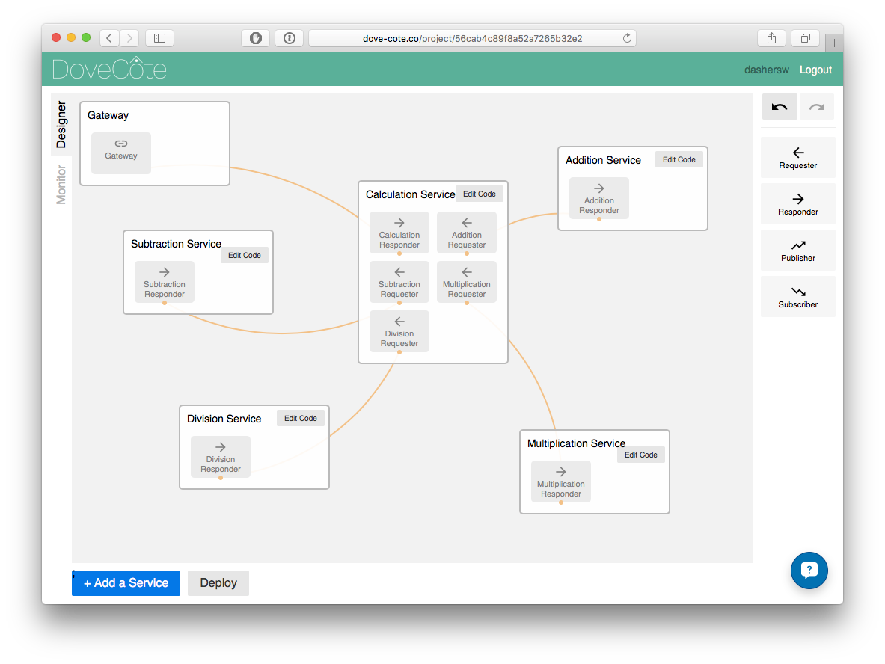

This article is about bringing up an idea and an implementation of how microservices should be built. DoveCôte is a *platform-as-a-service* for building, maintaining, deploying and monitoring microservices applications in the cloud.

Check out [https://dove-cote.co](https://dove-cote.co) for a test-ride. Tweet to us at [@DoveCote\_PaaS](https://twitter.com/DoveCote_PaaS) and join [our #slack community](https://slack.dove-cote.co) if you are interested.

Read [this great post](https://medium.com/@ustunozgur/how-we-built-dovecote-a-revolutionary-microservices-paas-for-the-masses-for-the-koding-global-5764e7cff958#.ca3w0xw8o) by Ustun Ozgur on how we built DoveCôte.

### The current state of developing microservices applications

The development world is on fire with microservices. It’s all the rage, and the *hype*. Companies of the past are re-branding to include microservices in their names, and strive to make sure that their solution is compatible with microservices—not only that but that their solution also makes microservices even better!

Unfortunately, the hype is so intense that even a standard web server can market itself as a microservices solution. There are a bunch of immense problems that need to be tackled, though, and these solutions are simply incapable of solving them.

- How do you design & develop microservices?
- How do you test your microservices locally?
- How do you configure the communication between your services?
- How do you deploy your services?
- How do you monitor your services’ health?
- How do you visualize your huge web of services?
- How do you scale?

Unfortunately, most tools solve only one or two of these problems for you, and building a solid architecture is mind-boggling at best.

We tend to disagree. We think there should exist a better way of doing microservices, and we built a solution to showcase what we think it should look like.

Here’s a 5-minute video to get started:

<div class="embed video"><iframe src="https://player.vimeo.com/video/156228277" title="DoveCote Demo" loading="lazy" allowfullscreen></iframe></div>

```text
Disclaimer: DoveCôte is built as an entrant in Koding Hackathon 2016. All the work you see is developed in only 48 hours. It is a proof-of-concept implementation to demonstrate a much bigger vision. Therefore it has a lot of rough edges. Some of the features mentioned in this article are not implemented yet.
```

## The DoveCôte way of microservices

- Developers should be able to develop and test their services locally, ***without*** any additional, hefty environment setup.
- A visual representation of interactions between services is a must on complicated systems. It should reflect the actual architecture of services.
- Developers shouldn’t worry about configuring service discovery—i.e., in which address each service lives.
- Microservices should scale out-of-the-box. No extra configuration should be necessary.
- It shouldn’t matter to the developer where their services are deployed physically. This is actually the definition of the cloud—as-serverless-as-possible.
- Health monitoring is ***extremely*** important. We can’t state this enough. Any broken link in a series of microservices is a dead-end.
- Microservices could be built in a stateful fashion. A service shouldn’t depend on a 3rd-party solution for keeping a simple, temporary state.

Currently, the best bet on serverless architectures is AWS Lambda. It’s a service that lets you *upload your services as zip files* (yes…) and AWS schedules and runs them in the cloud. The problem with Lambda is it’s simply developer-hostile. Vendor lock-in is a huge problem, and testing and deploying your functions is another, huge*-r* problem.

### How does DoveCôte solve these problems?

DoveCôte has 2 main interfaces. One is the design tab, and the other is the monitor tab. In the designer, you simply drag and drop services and components onto the canvas. Most of the code and all the hustle of configuration is handled automatically, so you just have to type what your function does, in an event-driven fashion.

### Design

Here’s an example of a service that adds two numbers:

```js
module.exports = function(additionResponder) {
    additionResponder.on('add', function(req, callback) {
        callback(req.firstNumber + req.secondNumber);
    });
};
```

That’s it. DoveCôte deploys this as a public endpoint for you, so it’s instantly available to the internet. The *additionResponder* here is a box you drag-and-drop in the editor, and it’s automatically injected into your function.

The beauty of this design is that it lets you require *any* Node.js library. You could require mongoose and use a MongoDB database on the other end of the world. You could require mqtt and delve deep into the world of IoT. What tools you are going to use in your services are entirely up to you, and you are not vendor-locked-in in any way.

Behind the scenes, DoveCôte makes use of the excellent library [cote](https://github.com/dashersw/cote) for interoperability, service discovery and communication among your services.

Drag-and-drop your services and components, wire them together with virtual pipes and you are done.



Once you are satisfied with your code, a single click deploys your application to the cloud and gives you a public endpoint, as well as documentation and sample code generated to test your services. Copy/paste the samples into the browser’s console and instantly test if your services work.

The good thing is, although it all looks like magic, it’s just intelligent design. The mechanism behind DoveCôte is so simple and idempotent, it can run on your local machine by just including a small bootstrap module in your code. Design in the frontend and download your code and run it locally. Or develop locally and just upload your code with a single command to see it in the designer. It works both ways. Locally, your services run on your machine. When deployed they run in… why should you care? It just works. But if you wonder, DoveCôte runs your services in isolated Docker containers, so that they can be deployed on any server and are guaranteed to work wherever they are. You can even throw in your own pool of machines.

### Monitor

Visualizing communication among the services are extremely important in microservices. Often you will find that a single request goes through 5–8 services in order to be answered. Therefore it’s essential that you see which service is connected to another. The monitor tab gives you a visual overview of your services, their connections, and a log of all of your services combined in an intuitive interface.

These two interfaces solve the problem of designing, visualizing, orchestration and monitoring of your services. Service discovery is automatic. Deployment is also automatic, so the only thing left to you is to enjoy your set up.

## Final Thoughts

There is an undeniably huge potential for microservices. Unfortunately, there are no flexible solutions on the market yet. DoveCôte provides a vision for building effortless, serverless, zero-configuration microservices at the expense of *nothing*.

<blockquote class="pull">

Developers and sysadmins, you have nothing to lose but your chains.

</blockquote>

Spread the word, and help the microservices revolution begin.

In the next article, we will talk about how we built DoveCôte.

Check out [https://dove-cote.co](https://dove-cote.co) for a test-ride. Tweet to us at [@DoveCote\_PaaS](https://twitter.com/DoveCote_PaaS) and join [our #slack community](https://slack.dove-cote.co) if you are interested.
