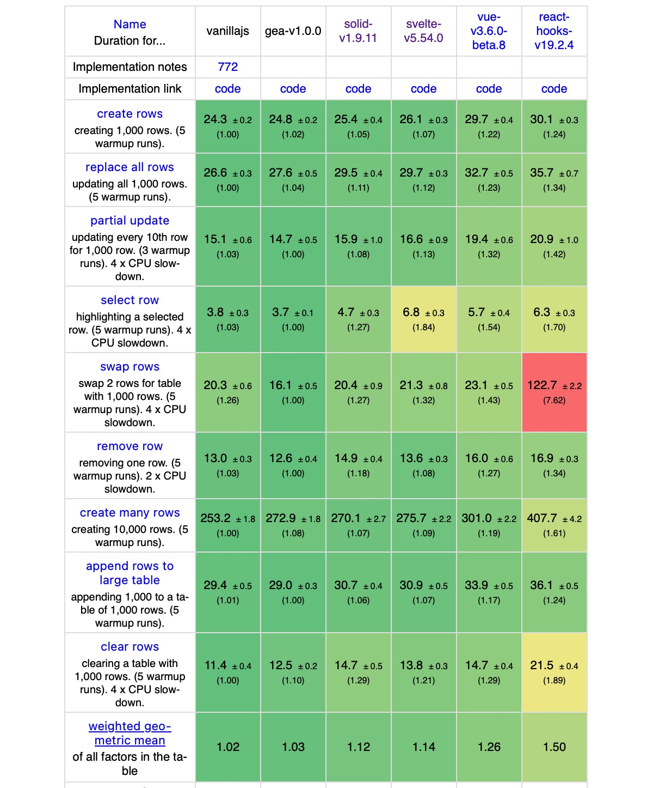

## Background

I started writing type-safe, component-driven web applications in JavaScript 16 years ago, thanks to [Google Closure Library](https://github.com/google/closure-library). It led to the creation of [tartJS](https://github.com/tart/tartjs), which went on to power the world's first client-side rendered, single-page [e-commerce application](https://playstore.com/). Yes, Google didn't have the Play Store brand back then.

tartJS was so systematic to write that 11 years ago I had a idea. What if we could capture all the boilerplate in a compiler and write completely reactive JavaScript, like writing OOP code? It was a crazy idea at the time, React was just picking up, and no one thought it would be feasible. In the meantime, frameworks like [Svelte](https://svelte.dev/) came onto the field that fulfilled some of the promise.

In 2017 I released [erste](https://github.com/dashersw/erste), a modernized version of tartJS that simplified event-handling and much of the boilerplate. Between 2012 and 2019 tartJS and erste enabled me and my teams to write a handful of mobile applications that felt truly native in a Cordova shell, thanks to 0-overhead performance. And ever since I released the first version of erste, I wanted to write my dream framework, the truly compiled, truly reactive, zero-concept framework.

## Introducing Gea

Fast-forward 7 years and I am proud to introduce [Gea](https://geajs.com/): A compile-time UI framework that turns **ordinary classes and functions** into surgical DOM updates. No virtual DOM. No hooks. No signals. Just your code — made reactive at build time. And it turned out to be the fastest compiled UI framework ever benchmarked. One percent behind hand-written vanilla JS.

Here's a complete counter component in Gea:

```jsx
class Counter extends Component {
  count = 0

  increment() { this.count++ }
  decrement() { this.count-- }

  template() {
    return (
      <div class="counter">
        <span>{this.count}</span>
        <button click={this.increment}>+</button>
        <button click={this.decrement}>-</button>
      </div>
    )
  }
}
```

increment() { this.count++ }
decrement() { this.count-- }

template() {
return (
<div class="counter">
<span>{this.count}</span>
<button click={this.increment}>+</button>
<button click={this.decrement}>-</button>
</div>
)
}
}
```

That's it. State is a class property. Methods mutate it directly. The template reads it. this.count++ triggers a DOM update. No useState, no signals, no dependency arrays, no wrappers. Just a JavaScript class.

The Vite plugin analyzes your JSX at build time, figures out which DOM nodes depend on which piece of state, and generates surgical patches that update only what changed. No diffing, no reconciliation, no runtime overhead. Just direct DOM mutations, wired up at compile time.

Stores work the same way for shared state:

```jsx
class CounterStore extends Store {
  count = 0

  increment() { this.count++ }
  decrement() { this.count-- }
}
```

increment() { this.count++ }
decrement() { this.count-- }
}
```

Plain classes with properties and methods. Computed values are getters. Arrays are intercepted so push, splice, and sort produce fine-grained change events. The framework doesn't fight the language. It uses the language.

I benchmarked Gea against major frameworks using [js-framework-benchmark](https://github.com/krausest/js-framework-benchmark), the industry-standard stress test. The results surprised even me:



Lower is better. Gea is one hundredth behind hand-written vanilla JavaScript, and ahead of every compiled framework. And Gea achieves this without inventing a single new programming concept.

But performance **wasn't** the actual goal. I wanted batteries included with **zero-decision fatigue**. Gea ships with;

- a built-in client-side router,
- a built-in store for state management,
- 35+ accessible UI components built on Zag.js,
- mobile primitives with iOS-style navigation and gestures (based on erste),
- a VS Code/Cursor extension for code intelligence (coming soon),
- and a project scaffolder that lets you start a new Gea project in seconds.

The whole runtime is ~13 kb gzipped with the router. Zero runtime dependencies.

It also ships with **agent skills** — structured documentation that teaches Cursor, Codex, and other AI assistants the full Gea API. Point your AI editor at a Gea project and it understands stores, components, JSX conventions, and the reactivity model out of the box. You can scaffold and iterate on Gea apps with complete AI assistance from the start.

This framework is the distillation of 15 years of building component-driven applications in JavaScript — from the early days of Google Closure, through tartJS and erste, to Gea. Every lesson, every frustration, every "why does the framework make me do this?" moment went into making Gea a place where you just write JavaScript and everything works.

Get started in one command:

```bash
npm create gea@latest my-app
```

MIT licensed. Fully open source. Available on GitHub at [https://github.com/dashersw/gea](https://github.com/dashersw/gea).

*First published [on X](https://x.com/dashersw/status/2034358153601835381).*
