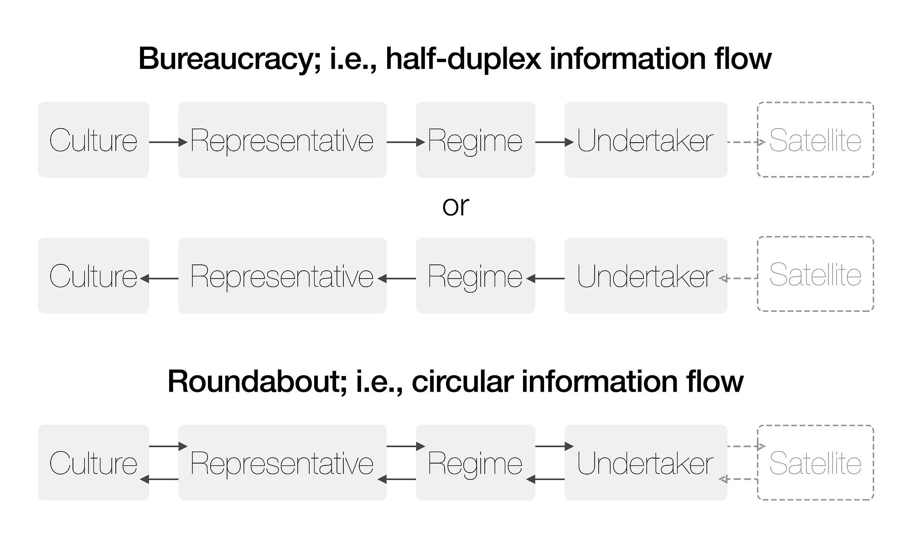

*Framework-agnostic, forward-thinking UI architecture*

## Introduction

The JavaScript community is teeming with new approaches to common architectural problems every other day. The amount of information that surfaces in a week is probably more than it did in a year, just 15 years ago. It seems that every other developer is introducing a new approach, and one has to spend hours after hours if they want to learn these in detail.

Some ideas are new, but most of them are just a rebranding and mashup of old ideas. Of course, it is safe to claim that there is nothing really new under the sun. In fact, GUI programming is a field that’s being pursued for about 40 years. It would be naïve to say that an idea is brand new, in this sense.

But so here we are. I present you *Vieux*, a new approach to building scalable and maintainable JavaScript applications. *Vieux* specializes not only in its gorgeous approach, but also its use of terminology. When designing *Vieux*, we got inspired by the things around us. Hopefully, you will feel at home with this down-to-earth, contextual naming convention.

## Motivation

We believe that software developers deserve better. So we are unveiling an architecture that we’ve been internally using for about 4 years. The best thing about *Vieux* is that it’s just a set of ideas that you can implement anywhere. Whether you are using Vanilla JS, Angular, React or any other framework, *Vieux* is easy to reason about, and easy to implement.

We believe that software developers deserve better. There is an ongoing debate about what MVC means, or what a Store is and how it should be implemented. Every framework and every developer has a different connotation for these keywords. So we wish to end the ambiguity once and for all.

## Approach

*Vieux* is based on a modular, componentized architecture. We believe that Single Responsibility is a great idea when it comes to building applications; so *Vieux* is against roles that span multiple responsibilities. This gives us the edge that every part of an app is self-evident.

*Vieux* won’t keep you from introducing new roles to it, though. We know that every application is unique, and one could certainly need a different role than what are being currently offered in *Vieux*. So, *Vieux* is not a dogma, but a pointer in the direction of salvation. It’s a general frame that you can paint inside, to your heart’s content. As long as you don’t paint over the frame, the end result will satisfy you.

## Structure

*Vieux* offers 7 different roles to sketch your application in a 3-tier architecture. Five of the roles are at the core of *Vieux* and they are named *Culture*, *Representative*, *Regime*, *Undertaker* and *Stereotype*. The last two, *Diplomat* and *Satellite*, are auxiliary roles, from which more complex applications would benefit.

Apart from these roles, *Vieux* also makes use of a concept called *Unions*. *Unions* are a contextual group of roles, comprising of related *Cultures*, *Representatives*, *Regimes*, etc. Normally, *Unions* are contextual associations. They exist to imply a close collaboration within a group of roles. *Unions* are useful when drawing the big picture, dealing with folder and file organizations in an application and provide an easier mental model of your code structure.

*Vieux* favors *bureaucracy — half-duplex information flow, if you will—*so the data flows only in one direction at any given time, as in the following example:

## A simple overview

In the most abstract terms — that no one can get their heads around — every application models a state. In *Vieux*, *Regimes* are responsible for keeping the application state *in memory*, usually represented through *Stereotypes*. If necessary, they persist their state through stateless *Undertakers*. For different persistence mechanisms, (eg. WebSQL, LocalStorage, AJAX or WebSockets) *Undertakers* may use different *Satellites. Cultures* are what the end-users are presented. They are stateless and as dummy as possible. Their state is kept and translated to the application state via *Representatives*. That is, *Cultures* inform *Representatives* when an update from the user is received; and *Representatives* process this update appropriately before transmitting it to a relevant *Regime*. An application consists of a number of *Regimes*, obviously, and their communications are carried out with *Diplomats*.

## Roles

### Stereotype

A *Stereotype* is an embodiment of a unique piece of information in your application. It might be a user, an account, a product, a shopping cart item, a credit card, or any unique embodiment that your application operates on. They hold a state in memory, and may include minor behaviors for manipulating some of their properties. *Regimes* are responsible for the creation and management of *Stereotypes*.

### *Culture*

*Culture* is a role that determines your user interface. It defines what your users see on the page. *Culture* includes a lot of predefined *behaviors*, like what happens when a user clicks on a button. *Cultures* are extremely dummy, in that they have no memory, or state, of their own. They know how to draw a user interface and how to handle user input; which they delegate to the *Representatives*.

*Cultures* can contain other *Cultures*, in which case the children would be called *subcultures*. A list of clickable items in an application would be an instance of a *Culture* **List**, and individual items would each be instances of another *Culture* **ListItem**. Here, **List** has a number of **ListItem**s as its *subcultures*. Obviously, both *Cultures* have different behaviors and responsibilities. You see where we are getting at.

Every *Culture* has a *Representative* of its own. Some *Cultures* are broad and generic, while others present *Stereotypes* to the end user. In the above example, *Cultures* **List** and **ListItem** are responsible for presenting respective *Stereotypes* to the user.

*Cultures* may welcome other, arbitrary *Cultures* as *immigrant subcultures*. These are commonly used as placeholders, as in modal presentations, whose content may vary greatly and therefore separated from a modal implementation.

### Representative

A *Representative* has two responsibilities. First, it keeps the state of its related *Culture*, and second, it is responsible for negotiating some of the behaviors of *Cultures* with respective *Regimes*. These negotiations may include transformations, filtering, or other means. If a *Stereotype* is involved in the *Culture* for a given *Representative*, the *Representative* is also responsible for keeping the *Stereotype*.

### Regime

A *Regime* is a stateful institution that deals with all the aspects of a specific purpose in an application. They breed, keep state of, and operate on *Stereotypes.* For complex task that would span different responsibilities, a *Regime* should negotiate with other *Regimes*, preferably over *Diplomats*. Although they are responsible for keeping application state of a specific purpose, *Regimes* don’t necessarily involve in *persisting* that state. For persistence, *Regimes* should delegate to *Undertakers*.

It’s worth mentioning that in very complex applications the developer may choose to implement two layers of *Regimes* on top of each other.

UI Applications often need to keep a global state for application life cycle management. We recommend using a *GlobalRegime* for this purpose.

### Undertaker

An *Undertaker* is responsible for persistence, serialization and deserialization of *Stereotype* instances. *Undertakers* are completely stateless, and only deal with information passed onto them by *Regimes*. Normally, an *Undertaker* would use one specific technology for persistence, such as AJAX, WebSockets, or LocalStorage.

In some rare circumstances, the same data (or a variation of it) might need to be persisted to two different technologies. In this case, the developer may choose to delegate technology-specific persistence responsibilities to individual *Satellites*.

### Satellite

A *Satellite* is a stateless role, whose purpose is to abstract away a certain persistence technology. *Satellites* persist serialized data. Most applications work with a single technology, so *Satellites* are mostly redundant.

### Diplomat

A *Diplomat’s* principal concern is to foster peaceful relations between *Regimes*. *Diplomats* are quasi-autonomous in nature, in that they deal with *Regimes*, but are not owned by, or disposed by *Regimes*. They live as singletons, and are tasked with carrying out events to listeners. A *Regime* can choose to publish an event over a *Diplomat*, and other *Regimes* who are interested can receive the event and operate as a result.

In other circumstances that deal with UI state, reaching out to *Regimes* are unfavorable. When this is the case, *Representative-level Diplomats* can also be used.

## Conclusion

The ideas presented in *Vieux* are the pillars of a maintainable application architecture. It’s been used in huge JavaScript applications in production since 2011. We thought it would fade over with time, but to our surprise, the ideas in *Vieux* matured with every new framework since then.

Today, *Vieux* is a suitable application architecture for nearly every major framework. In fact, we are hard at work with providing example implementations of *Vieux* on every framework we can get our hands on. Check out our [GitHub organization](https://github.com/vieuxio) for examples and further ideas. It’s still very young, and we’re working hard on bringing it up as an extensive resource for all your needs. We currently have;

[A chat application example with Google Closure](https://github.com/vieuxio/example-chat-closure),\
[A chat application example with React](https://github.com/vieuxio/example-chat-react),\
[A chat application example with AngularJS](https://github.com/vieuxio/example-chat-angularjs),\
[A chat application example with Vanilla JS](https://github.com/vieuxio/example-chat-vanilla) (WIP),\
[A chat application example with ES6](https://github.com/vieuxio/example-chat-es6),

[And a growing Wiki with further elaboration](https://github.com/vieuxio/vieux/wiki)

Meanwhile, you can join us at our ***#slack community*** at\
[http://slack.vieux.io](http://slack.vieux.io).

*Vieux* has shed a pleasant light on our journeys in GUI programming for about 4 years. We believe it’s mature and battle-hardened enough to share it with the world, and we hope that it will also be a good companion for you.
