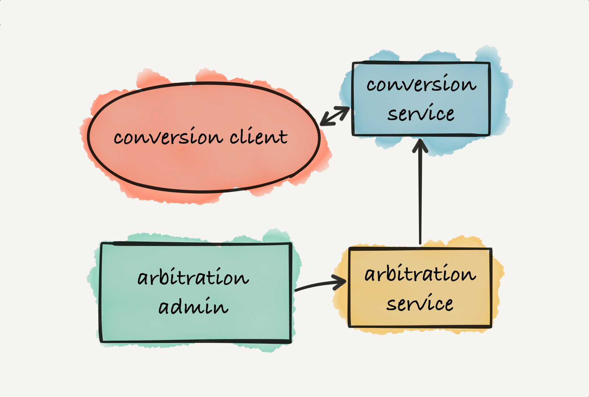

<figure>


<figcaption>

[”doves”](https://www.flickr.com/photos/franzj/9641334657/in/photolist-fFYmTT-TPKqof-7zh8BH-tUgn2p-4WKeSE-dR3Cm2-2ayuJ7-gUoL14-5CVYFn-6sfVdz-8yFwAV-8CQePn-58moVE-EP4fu-adsNYn-9WCA4k-4u2WkR-SUB9on-TeyeXA-TdXQDW-gDSQy-o8zYqJ-doxC2x-AsCmm8-dsD3Js-T3mEKw-Sz5oT-7GaH5a-9ZmBmM-b8XYz-nVrH2u-brvwXe-4vAaH8-5geYoF-q1w5Ap-6dNnDn-4dZZ87-6U7jEg-QCuvab-87tyLJ-69WBpX-zmzAy-6pqDDy-dYMB4b-8CQf1r-dmMTpf-8CTjQy-8CTj9E-EaQaF-4F8W8J) by [Franz Jachim](https://www.flickr.com/photos/franzj/) is licensed under [CC BY-NC-ND 2.0](https://creativecommons.org/licenses/by-nc-nd/2.0/)

</figcaption>
</figure>

Microservice architectures are all the rage at the moment, and I know it already makes the *true practitioners* cringe at the sound of the word. But it’s a worthy change, one that might forever change how we write server software. Therefore, we should be talking more about the true properties of microservices and work on making it easy to adopt and use.

If you are cautious about microservices or feel a little intimidated by it, you are not alone. Microservice architectures are rightfully complex. But what is worse is the ecosystem around this topic. Instead of solving this complexity directly, the players in the ecosystem just choose to shift and juggle the complexity from one point to the other. In the end, one has to maintain a huge list of technologies and deal with bugs that are impossible to debug due to complexity; just to make sure their application is healthy.

## The goal of this post

This post will walk you through your first microservices application. In fact, if you are savvy around Node.js, developing your first microservice takes under two minutes.

*Before we start, here’s a disclaimer: I am the author of* [*cote*](https://github.com/dashersw/cote)*, which is a nifty Node.js library that does all the upcoming magic for us.*

### A sample microservices implementation

There are many different ways of demonstrating implementation of a microservice architecture, and in fact, a [thorough example](https://github.com/dashersw/cote-workshop) would work best for seasoned practitioners. But this post is for welcoming the uninitiated, so I picked a very basic, yet effective example: a currency conversion application. We will be building four different services that collaborate to accomplish currency conversion with variable conversion rates.

<figure>



<figcaption>

A simple overview of services. Each service can scale independently, and arrows indicate the direction of data flow.

</figcaption>
</figure>

We will build;

- a **conversion client** that can request conversion of a certain amount of money in a currency into another
- a **conversion service** that knows the conversion rates and can respond to said requests. It can also receive updates to conversion rates
- An **arbitration service** that keeps the actual conversion rates and publishes changes to the system if any rate has changed
- And finally, the last service that is left to you as an exercise, an **arbitration admin** that tells the arbitration service to update a certain conversion rate.

## But first a little subjective *history*

Let’s roll back a little. 10 years ago, before microservices was even a thing, engineers were using SOA — service-oriented architecture. There were hundreds of solutions for building service-oriented apps, and a healthy consultancy business around it. Fast-forward some seven years, and you have microservices. Although it is fundamentally very different from SOA, the folks who previously did SOA adopted microservices… with all the baggage of the past.

Overnight, they carried over their approaches and solutions over to the new landscape. While the basic premises of microservices were in fact different than SOA, these solutions stuck as the “only truth”. So we had among others AMQP, HTTP or even SOAP, heaven forbid; nginx, zookeeper, etcd, consul and several other solutions that were touted as *“you-have-to-use-these-to-make-a-microservices-architecture”* kind of tools. The problem with these solutions is that they are “retro-fitted” for microservices, meaning that they were actually born to solve different problems. However, when you use several of these tools to design your services, they feel *makeshift* at best. It’s like using pliers to hammer a nail. In the end, yes, it works. But is it correct?

It was and has always been evident that the barrier to entry for microservices was just too high, though it was lucrative as a business. But the year is 2017, and we deserve better than that. So it’s time I tell you that in order to learn and do microservices properly, *you only need Node.js*. No other technology is necessary to employ and scale your microservices application to hundreds of machines. That’s right. *Not even nginx.*

Next, let’s look at what makes a true microservice architecture.

## Five Rules of Microservices

The requirements for microservices can be summed up in five rules;

1. **Zero-configuration:** any microservices system will likely have hundreds of services. A manual configuration of IP addresses, ports and API capabilities is simply infeasible.
2. **Highly-redundant:** service failures are common in this scenario. So it should be very cheap to have copies of such services at disposal with proper fail-over mechanisms.
3. **Fault-tolerant:** the system should tolerate and gracefully handle miscommunication, errors in message processing, timeouts and more. Even if certain services are down, all the other unrelated services should still function.
4. **Self-healing:** it’s normal for outages and failures to occur. The implementation should automatically recover any lost service and functionality.
5. **Auto-discovery:** the services should automatically identify new services that are introduced to the system to start communication without manual intervention or downtime.

If your architecture demonstrates these capabilities and if you are breaking down the fulfillment of most of your API requests into several independent services, then, yes, you are doing microservices.

### What microservices aren’t

I would, once again, like to underline: microservices architecture is not about which technology you use. Your plain old work queues and consumers are not microservices. E-mail daemons, notifications, and any auxiliary services which only consume events in the system and don’t contribute to a user request — they are not microservices. Is your back-office a separate application than your client app? That separation is not microservices either. Your backend daemons which can consume HTTP requests… they are also not microservices. The server farm, the machines that you so cheerfully and carefully named after Jupiter’s moons, do they require manual intervention? If that’s the case, no, you’re not doing microservices. I understand how tempting it is to tag whatever your system is with the name *microservices*… but that’s not microservices. Calling these microservices actually creates information pollution, and prevents other people from truly embracing this otherwise-pretty-handy approach.

<blockquote class="pull">

Microservices have always been about being lean. Bulky technologies that claim to “***enable”*** microservices are exactly the opposite.

</blockquote>

### How cote enables true microservices

cote is zero-configuration. It uses IP broadcast or multicast, so that daemons on the same network discover each other and automatically exchange whatever configuration is necessary for connection. In this regard, cote satisfies rule #1 and #5, **zero-configuration** and **auto-discovery**.

It’s very cheap and effective to create multiple copies of services with cote, and requests are automatically load-balanced. This gives you rule #2, **high redundancy**.

When there are no services to fulfill a particular request, cote caches them until such a service is available. Since every service is basically independent of each other, such a system provides **fault-tolerance**, rule #3.

The remaining rule #4, **self-healing**, is achievable through Docker, which makes sure to restart a service whenever it fails. Since the system works with auto-discovery, even if Docker decides to deploy that failed service to a new machine, all the other remaining services will discover the new replacement and start communicating with it.

As such, cote gives you complete freedom over your infrastructure by taking care of the fundamental rules of microservices.

<blockquote class="pull">

With cote, you can finally focus on the most important aspect, developing your application.

</blockquote>

## Talk is cheap, show me the code

I believe I have made clear the case for true microservices. Now let’s see how to implement these in real life, with real code.

### Let’s get started

We will be implementing our microservices in Node.js with a library called [cote](https://github.com/dashersw/cote), which is a Node.js library for building zero-configuration microservices applications. It’s available as an [npm package](https://npmjs.org/package/cote).

Install cote via npm:

```bash
npm install cote
```

### Using cote for the first time

Whether you want to integrate cote with an existing web application — e.g. based on express.js as exemplified [here](https://github.com/dashersw/cote-workshop/blob/master/admin/server.js) — or you want to rewrite a portion of your monolith, or you want to rewrite a few of your microservices with cote, all you do with cote is to instantiate and make use of a few of cote’s components (e.g. [Responder](https://github.com/dashersw/cote#responder), [Requester](https://github.com/dashersw/cote#requester), [Publisher](https://github.com/dashersw/cote#publisher), [Subscriber](https://github.com/dashersw/cote#subscriber)) depending on your needs. These components are designed to communicate with each other to realize the most common scenarios in application development. While one component per process might be enough for simple applications or for tiny microservices, a complex application would require close communication and collaboration of multiple components and multiple microservices. Hence, you may instantiate multiple components in a single service/process/application.

We will start with implementing our client in this application, which we may conveniently call `conversion-client.js`. It shall ask for certain currency conversions to be made, and act upon the response.

### Implementing a request-response mechanism

The most common scenario for applications is the request-response cycle. Typically, one microservice would request a task to be carried out or make a query to another microservice, and get a response in return. Let’s implement such a solution with cote.

First, require cote;

```js
const cote = require('cote');
```

It’s your regular old library require call.

### Creating a requester

Let’s start with a `Requester` that shall ask for currency conversions. `Requester` and all other components are classes on the `cote` module, so we instantiate them with the `new`keyword.

```js
const requester = new cote.Requester({ name: 'currency conversion requester' });
```

All cote components require an object as the first argument, which should at least have a `name` property to identify the component. The name is used mainly as an identifier in monitoring components, and it’s helpful when you read the logs later on as each component, by default, logs the name of the other components they discover.

`Requester`s send requests to the ecosystem, and are expected to be used alongside `Responder`s to fulfill those requests. If there are no `Responder`s around, a `Requester` will just queue the request until one is available. If there are multiple `Responder`s, a `Requester` will use them in a round-robin fashion, load-balancing among them.

Let’s create and send a `convert` request, to ask for conversion from USD into EUR.

```js
const request = { type: 'convert', from: 'usd', to: 'eur', amount: 100 };

requester.send(request, (res) => {
    console.log(res);
});
```

You can now save this file as `conversion-client.js` and run it via `node conversion-client.js`.

Here’s the whole `conversion-client.js` as a reference:

```js
const cote = require('cote');

const requester = new cote.Requester({ name: 'currency conversion requester' });

const request = { type: 'convert', from: 'usd', to: 'eur', amount: 100 };

requester.send(request, (res) => {
    console.log(res);
});
```

<p class="caption">The complete conversion-client.js file</p>

Now this request will do nothing, and there won’t be any logs in the console, because there are no components to fulfill this request and produce a response.

Keep this process running, and let’s create a `Responder` to respond to currency conversion requests.

### Creating a responder

We first require cote and instantiate a `Responder` with the `new` keyword.

```js
const cote = require('cote');

const responder = new cote.Responder({ name: 'currency conversion responder' });
```

Each `Responder` is also an instance of `EventEmitter2`. Responding to a certain request, let’s say `convert`, is the same as listening to the `convert` event, and handling it with a function that takes two parameters: a request and a callback. The request parameter holds information about a single request, and it’s basically the same `request` object the requester above sent. The second parameter, the callback, expects to be called with the actual response.

Here’s how a simple implementation might look like.

```js
const rates = { usd_eur: 0.91, eur_usd: 1.10 };

responder.on('convert', (req, cb) => { // ideally, you would sanitize your input here.
    cb(req.amount * rates[`${req.from}_${req.to}`]);
});
```

Now you can save this file as `conversion-service.js` and run it via `node conversion-service.js` on a separate terminal.

Again, a complete `conversion-service` would look like the following:

```js
const cote = require('cote');

const responder = new cote.Responder({ name: 'currency conversion responder' });

const rates = { usd_eur: 0.91, eur_usd: 1.10 };

responder.on('convert', (req, cb) => {
    cb(req.amount * rates[`${req.from}_${req.to}`]);
});
```

<p class="caption">The complete conversion-service.js file</p>

As you run the service, you will immediately see the first request in `conversion-client.js` being fulfilled and logged to the console. Now you can take this idea and build your services on it.

Notice how we didn’t have to configure IP addresses, ports, hostnames, or anything else.

<blockquote class="pull">

Congratulations, you’ve completed your first set of microservices!

</blockquote>

Now in separate terminals, you can run multiple copies of each service, and you will see that everything works perfectly. Stop a few conversion services, restart them, and you will see how this system effectively meets the 5 requirements of modern microservices. And if you want to scale out across machines and datacenters, you can either use your own infrastructure or use Docker to handle the breadth of the task of managing infrastructure.

### Pushing forward: Tracking changes in the system with a publish-subscribe mechanism

One of the benefits of a microservices approach is its ease of use as a tool for tasks that previously required serious infrastructural investments. Such a task is managing updates and tracking changes in a system. Previously, this required at least a queue infrastructure with fanout, and scaling and managing this technological dependency would be a hurdle on its own.

Fortunately, cote solves this problem in a very intuitive and almost magical way.

Say, we need an arbitration service in our application which decides currency rates, and whenever there’s a change within the system, it should notify all the instances of conversion services, so that they facilitate the new values.

The keyword here is “notifying all the instances of conversion services”. In a highly-available microservices application, we would have several conversion services sharing the load of your application. When there’s an update to the currency rates, these services should all be informed about the change. If there were only one conversion service, this could easily be achieved via a request-response mechanism. But since we want to be free to decide how many copies we run simultaneously, we need a mechanism that notifies every single conversion service, all at once. In cote, this functionality is achieved via publishers and subscribers.

Of course, the arbitration service would be API driven, and would receive the new rates over another request so that for example an admin can enter the values through a back-office application. The arbitration service should take this update and basically forward it to every conversion service. In order to achieve this, the arbitration service should have two components: one `Responder` for the API updates and one `Publisher` for notifying the conversion services. In addition to this, the conversion services should be updated to include a `Subscriber`. Let’s see this in action.

### Creating the arbitration service

A simple implementation of such a service would look like the following. First, we require cote and instantiate a responder for the API. Now, there is a small, but important way of building microservices with cote. Due to its zero-configuration nature, every `Requester` in the system will connect to every `Responder` it discovers, regardless of the request type. This means that every `Responder` should respond to the exact same set of requests, because `Requester`s will load-balance requests between all connected `Responder`s regardless of their capabilities, i.e, whether or not they can handle a given request.

In this case, we want to create a `Responder` for a different set of requests. This means we need to differentiate this from our regular services which exchange `convert` requests. In cote, this is done by simply defining a key for a component. Defining keys is the easiest way to regulate service communication. Here’s how we would create the said `Responder`.

```js
const cote = require('cote');

const responder = new cote.Responder({ name: 'arbitration API', key: 'arbitration' });
```

Now we need a mechanism to keep track of currency rates in our system. Let’s say we keep them in a local variable at the module scope. This could just as well be a database call, but for the sake of simplicity let’s keep this local.

```js
const rates = {};
```

Now the responder shall respond to an `update rate` request, allowing admins to update it from a back-office application. The back-office integration isn’t important at this moment, but [here is an example how back offices could interact with cote responders in the backend](https://github.com/dashersw/cote-workshop/tree/master/admin). Basically, this service should have a responder to take in the new rates for a currency exchange.

```js
responder.on('update rate', (req, cb) => {
    rates[req.currencies] = req.rate; // { currencies: 'usd_eur', rate: 0.91 }
    cb('OK!');
});
```

As an exercise, you can create a cote requester to, for example, make the `update rate` call periodically and vary the rate. Call this file `arbitration-admin.js` and make sure to incorporate `setInterval` to demonstrate variation in conversion rates.

### Creating a publisher

We now have the rates, but the rest of the system, namely, the conversion services aren’t aware of this change yet. In order to update them of the changes, we should create a `Publisher`.

```js
const publisher = new cote.Publisher({ name: 'arbitration publisher' });
```

Now whenever there’s a new rate, we should utilize this `Publisher`. The `update rate` handler thus becomes:

```js
responder.on('update rate', (req, cb) => {
    rates[req.currencies] = req.rate;
    cb('OK!');

    publisher.publish('update rate', req);
});
```

With the publish functionality implemented, here is the complete `arbitration-service.js` file:

```js
const cote = require('cote');

const responder = new cote.Responder({ name: 'arbitration API', key: 'arbitration' });
const publisher = new cote.Publisher({ name: 'arbitration publisher' });

const rates = {};

responder.on('update rate', (req, cb) => {
    rates[req.currencies] = req.rate;
    cb('OK!');

    publisher.publish('update rate', req);
});
```

<p class="caption">The complete arbitration-service.js file.</p>

Since currently there are no subscribers in this system, nobody will be notified of these changes. In order to facilitate this update mechanism, we need to go back to our `conversion-service.js` and add a `Subscriber` to it.

### Creating a subscriber

A `Subscriber` is a regular cote component, so we instantiate it with the following:

```js
const subscriber = new cote.Subscriber({ name: 'arbitration subscriber' });
```

Put this line in `conversion-service.js`.

`Subscriber` also extends `EventEmitter2`, and although these services might run in machines that are continents apart, any published updates will end up in a `Subscriber` as an event for us to consume.

Update `conversion-service.js` and add the following to listen to updates from the arbitration service.

```js
subscriber.on('update rate', (update) => {
    rates[update.currencies] = update.rate;
});
```

That’s it! From now on, this conversion service will synchronize with the arbitration service and receive its updates. The new conversion requests after an update will be done over the new rate.

So far we have created three services that work together to realize a currency conversion system based on microservices. For a recap, I have created [a repository on GitHub](https://github.com/dashersw/cote-examples-currency-conversion) that incorporates all these services plus an automatic arbitration updater. Feel free to clone and play with it.

## Conclusion

This article barely scratched the surface of microservices. It should be taken as an introduction to proper microservice architectures, where we employ similar approaches in larger scales. There’s also a lot of exciting features in cote that are not covered here.

I believe we are on the brink of very interesting and exciting times with respect to how we structure our software, and I strongly support the simplification of our methods. [cote](https://github.com/dashersw/cote) is an effort in that regard and it’s only the beginning. It’s already time to enable the world of microservices for everyone.

## Further steps

Take a look at [our GitHub repository](https://github.com/dashersw/cote), and [join our Slack community](http://slack.cotejs.org) if you want to experiment with cote. We are also looking for active contributors, so let us know if you are interested in taking on the challenge of making microservices accessible.

As an advanced, all-in example, we have [another GitHub repository](https://github.com/dashersw/cote-workshop) that showcases a simple e-commerce application implementation with cote. The example gives you the following out of the box;

- a back-office with real-time updates for managing the catalogue of products and displaying sales with a RESTful API (express.js)
- a storefront for end-users with real-time updates to products where they can buy the products with WebSockets (socket.io)
- a user microservice for user CRUD
- a product microservice for product CRUD
- a purchase microservice that enables users to buy products
- a payment microservice that deals with money transactions that occur as a result of purchases
- Docker compose configuration for running the system locally
- Docker cloud configuration for running the system in Docker Cloud

If you wish to experiment with cote in Docker and Docker Cloud, I also have a webinar recording which is a step-by-step guide from zero to running cote microservices in production scale with continuous integration:

<div class="embed video"><iframe src="https://www.youtube-nocookie.com/embed/r_ijnhvrUD4" title="Node.js Microservices with Docker Cloud w/Armağan Amcalar" loading="lazy" allow="accelerometer; encrypted-media; gyroscope; picture-in-picture; fullscreen" allowfullscreen></iframe></div>

And that’s it! Thanks a lot for reading this article, and please share your thoughts in the comments.

*If you liked this, click the* 💚 *below to show your support and spread the word.*

*Armağan Amcalar* *is a software architect from Berlin. He is creating the future of mobility as the* ***Head of Software Engineering*** *at* [*unu*](https://unumotors.com)*. As a* ***university lecturer*** *and a* [***mentor***](https://lonca.works)*, Armagan teaches JavaScript and software architecture in various contexts. He has created* [*several*](https://github.com/dashersw/erste) [*open-source*](https://github.com/dashersw/pedalboard.js) [*frameworks*](https://github.com/dove-cote/dovecote) [*and*](https://github.com/vieuxio) [*projects*](https://github.com/tart/semaver) *on* [*GitHub*](https://github.com/dashersw)*. As* ***a public speaker****, he loves to* [*speak about software*](https://slides.com/armaganamcalar) *in international conferences all over the world.*
