Kesuke Miyagi, the legendary Karate master from the movie series *Karate Kid*, is a tiny man you would otherwise mistake for a plumber.

<blockquote class="pull">

“Every Miyagi knows two things, fishing and Karate.”

</blockquote>

Karate is a family heritage that every Miyagi teaches his son. Karate is not only about fighting, but rather a means to end all the fights. It is not something that you would brag about. It is how you live your life, a natural extension of your soul and being.

This post is an interpretation of the teachings of Mr. Miyagi, who himself is a great master and an inspiring teacher.

I follow the [software craftsmanship movement](http://manifesto.softwarecraftsmanship.org), and believe a software career should be built upon these *simple-to-follow* yet *hard-to-master* principles.

Surprisingly though, software craftsmanship is a philosophy that is extremely congruous with the way of Mr. Miyagi. But, before that, let me briefly talk about crafts and software craftsmanship.

## **Craft|krɑːft|noun**

1. An occupation that favors **skilled labor** over capital and requires training, dexterity and mastery.

This is a very brief description of what a craft is. And I tend to add *“aesthetic perspective”* to this definition. Let’s dissect the definition to get a better understanding of what makes something a craft.

### Skilled labor

It is labor that produces a unique, value-added outcome. Monotonous effort is not enough, mass production is out of the question. A person who sells stuff they buy from a provider, a person that fills cigarettes in a factory, or a person that assembles circuitry for a technological product are not representatives of skilled labor. Instead, skilled labor requires a thorough education that is often complex and that takes years. In the end, skilled labor produces a **unique** outcome. Two end products are never the same. Software is a profession that requires such labor.

### Mastery

Software requires mastery. A young engineering graduate is not the same as an established engineer of many years of experience. Similarly, an engineer who has worked for many years in their field, yet failed to improve themself is not the same as a younger engineer with less years in the industry and trained very hard to improve. Becoming a master differentiates your way of doing your job and as you progress in the path to becoming a master, the outcome you produce gets distilled to perfection.

### Dexterity

Dexterity is required to perform or build seemingly-complex things, such as acrobatics or… disarming a bomb. It is the skill required to unravel comprehensive, entangled problems. In software, nearly all the problems you face, either bugs or feature development, are a tangled mass of ambiguity. In order to complete the tasks at hand *in time* and *with quality*, you have to be *dexterous*.

### Aesthetics

The unique outcome of skilled labor generally appeals to a taste. Great masters take pride in what they deliver, and don’t take a part in anything they would be ashamed to claim to have done. Master software craftsmen take aesthetics and taste seriously in everything they create, from the design of their APIs to software architecture, from the pixel-perfect layout of the frontend to the performance-optimized database. They produce stuff that appeals to both the eye, the soul and the brain. And every master has a personal style that is almost tangible in the work they deliver. An astute observer can deduce the master from the style the job is done in.

With these definitions in mind it is clear that software is a craft and software engineers are craftsmen. Unfortunately, our university education is far from an education of craftsmanship. Craftsmanship education usually takes long years where the student works on actual problems and does real work; getting their hands dirty producing real output. The secrets and the intricacies of craftsmanship is then transferred from the master to the apprentice, and this transfer is a result of a one-to-one interaction between them. Unfortunately, again, our mass-education system *(see the connection to mass production? It’s not craft.)* does not favor craftsmen. Most professors are usually academic only, with little to no first-hand experience in the industry.

Let’s go back to Mr. Miyagi. I would advise you to watch the first *Karate Kid* movie after you read this piece. If you ever thought about your relationship with the industry and there are some missing answers, I am sure you will discover many more lessons for yourself.

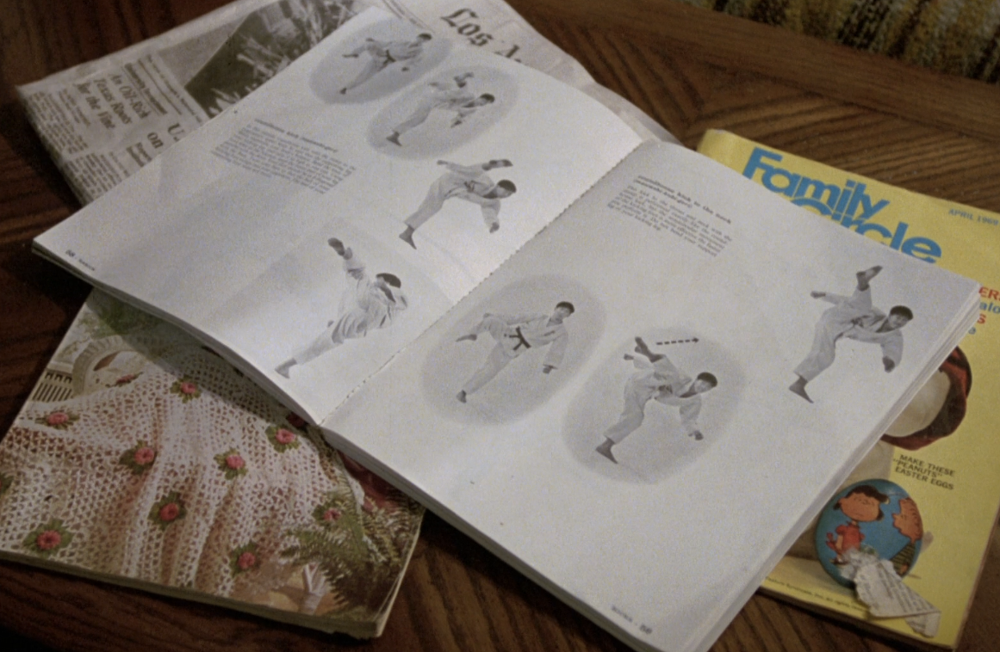

<blockquote class="pull">

Learning from the book?

</blockquote>

## Learn the philosophy.

Karate Kid, a.k.a. Daniel, is a young college student who learns Karate from books. When they meet for the first time, Miyagi is delighted to see the kid’s determination to train on his own. Yet, the first thing he asks, much to Daniel’s surprise, is “Learning from the book?”

The problem with learning from the book at the beginning of your career is… you see, books can show you a few tricks, with pictures, or code examples, but it is really hard to grasp the philosophy of why that code works and why you should write it that way, from those limited explanations. Maybe you have a question, or you have a prior experience that needs to be tackled before you can learn or perform that trick. Books are not interactive, they are not tailored to your needs, but training should be.

Unfortunately, school education offers little help in terms of individual care. The software industry is geared towards treating engineer labor as a commodity, expecting faster and faster delivery times. This makes it extremely hard for new graduates (apprentices) to find a good master and even harder for the masters to spare time to train apprentices. In fact, it is so hard that it is *almost a luxury*. This drives people to teach themselves and as a result, years of experience gathered and distilled in this industry cannot be transferred correctly or in whole to the younger generation. Every apprentice is forced to discover the fallacies and intricacies of the craft on their own.

This is a huge problem that tech companies struggle with. In the end, every apprentice spend a lot more time, in vain, than a master would spend to teach them. I don’t have the exact numbers to back this claim but from my own experience at [Startup Kitchen](http://startup.kitchen), I can say that it is a lot more efficient to teach apprentices and get them to produce real output than leaving them on their own to figure out the job. It looks like a waste of time in the beginning but it will have saved you a lot by the end of your journey.

The 80-20 rule is also prominent in software. Masters spend 20% of their time developing the crucial concepts for the 80% of the application; and then continue to spend the remaining 80% of their time to finish up the tedious details (this is also why we are terrible at estimation.)

Now the master can teach an apprentice or two in a percentage of that period, and let them finish up those tedious, finer details. The project costs will come down eventually, you will have taught people coding, and finally, keep your sanity by avoiding the tedious work. Next time, you will have better apprentices and the total cost will be lower.

Collaboration is important, but don’t underestimate the value of teaching in a collaborative environment. Oftentimes, pair coding sessions put together two developers from similar experience levels and as a result, very little teaching (and increase in total experience) occurs. This is done in order to avoid various conflicts between a senior and a junior developer. But taking a step back, and looking at the problem from a different perspective produces the optimum results: instead of expecting only an outcome in terms of work done, you should *also* expect the senior to teach the junior. Again, the final outcome could be lower in terms of completed tasks, but this is a good investment for your future.

By the way, Daniel’s rivals are students of a dojo called *Cobra Kai*. I have to say that, as a side-effect of this movie, I developed an allergy for names like “coder dojo”. Whenever I hear *dojo*, it reminds me of *Cobra Kai*.

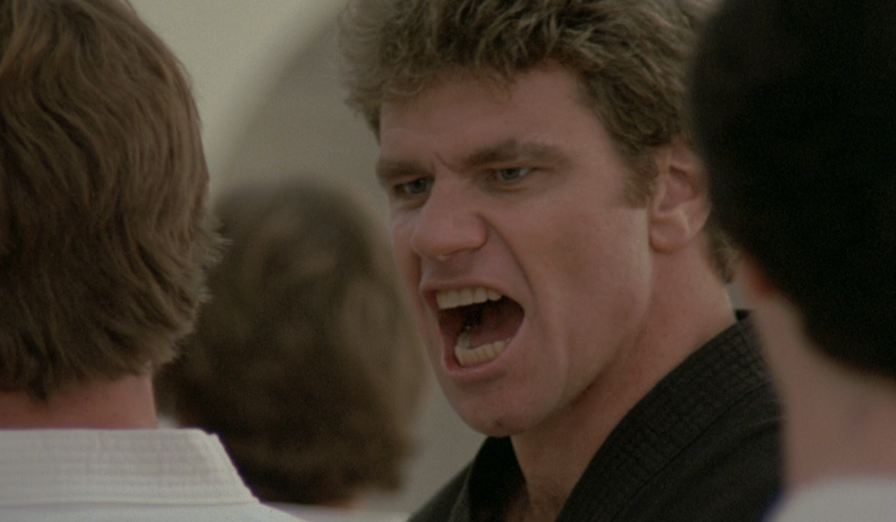

*— Fear does not exist in this dojo, does it?*

*— No, sensei!*

*— Pain does not exist in this dojo, does it?*

*— No, sensei!*

*— Defeat does not exist in this dojo, does it?*

*— No, sensei!*

## Do not heed the posers.\
Software is done by coding.

The students of *Cobra Kai* are like mindless zombies, repeating this nonsense over and over again. They are complete posers.

You will meet their counterparts in the software industry, who pose in a thousand different ways claiming they do everything, including this and that. They have big, flashy titles in front of their names. But just like Karate, great software is not achieved with posing, it is achieved by coding. And that code does not only come from your fingers, it pours out of your inner self. It is always easier to market yourself pompously, but the real challenge is to cut the crap, and show the code. Don’t be fooled by the so-called masters in your organization that walk around and brag about themselves. Code is hardly subjective and you will eventually develop a taste to differentiate good from bad. Don’t be intimidated, don’t give in.

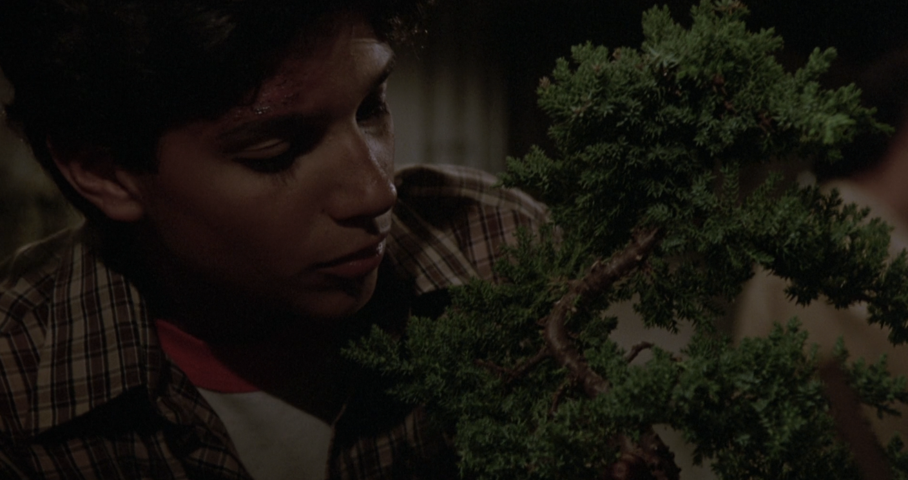

<blockquote class="pull">

Trust. Concentrate. Imagine a picture in your mind and apply it.\
If come from inside, the picture is always right.

</blockquote>

## Imagine and perfect your skills to match your imagination.

Mr. Miyagi is tending his Bonsai trees when he meets Daniel for the very first time. Daniel, who haven’t seen a Bonsai tree before in his life, cannot even tell if they are real.

The first thing that Miyagi does, that also assures he is a great teacher, is to encourage Daniel, a complete stranger to tending Bonsai trees, to actually try and shape one. He tells Daniel to close his eyes, concentrate on a picture of a beautiful tree in his mind down to the last needle and apply that picture to the tree in front of him.

Daniel says that he is a complete noob and asks how he will tell if the picture in his mind rightfully resembles a Bonsai tree. The answer, a quite legendary one, is this: “If come from inside, the picture is always right.”

Imagination is *extremely* important. Even though the code you are asked to write is the first time you do such a thing, dream it first. Complete the dream, down to the finest detail, and then get to work. Try to make it look like the one in your imagination, and keep doing it until it resembles your imagination as much as possible. In the end, if you cannot imagine, your results will only be mediocre.

This also shows how a software education should start, and progress. You have to *learn by doing*. You have to train and practice until you get the picture right. I am not talking about the tutorials you would find around the web, I am talking about *a real life application* that is of some *real use*. Get to work with a real application as your goal and learn the things you should know along the way.

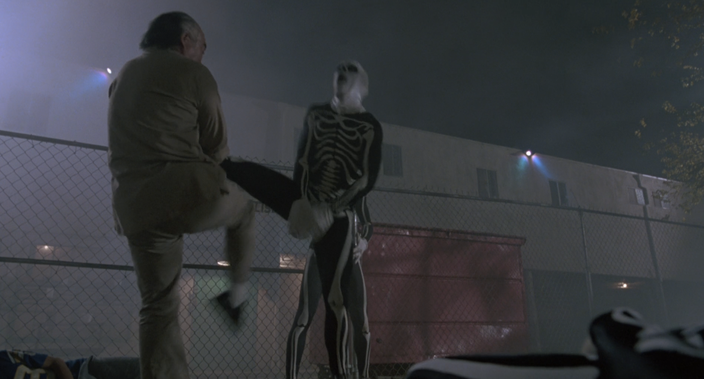

<blockquote class="pull">

The purpose of Karate is not only fighting.

</blockquote>

## Solve real problems,\
discover a better approach,\
create better code and better value.

Mr. Miyagi says that doing Karate has to have a purpose. You should either be defending yourself or protecting or saving a weak innocent. But the purpose of doing Karate is never, ever, only fighting. That is why, in the third movie, Mr. Miyagi refuses to teach Daniel who wants to join the Karate tournament to fight and defend his title. Because it is pointless. It has no real value.

The purpose of software craftsmanship is not only to code. This journey has to start with a challenge, a real purpose. Solving real problems of real people, discovering better approaches, improving yourself and your art, creating better and better solutions are all tangible, real things. If you only code for money (and status, etc.) it is not really different from being a merchant. Of course, being a merchant developer is a path followed by many and we are not to judge. But I chose my path as a craftsman instead of a merchant, as I believe it provides more value to everyone involved.

<blockquote class="pull">

You train to not have to fight.

</blockquote>

## Train to avoid fights.

One of the most important lessons Daniel has to learn is why he is training. He is not training to fight, he is not training to win the tournament. Quite the contrary, in fact, he is training to not have to fight!

In various scenes where you see Mr. Miyagi fight, one important observation is very striking. Mr. Miyagi moves very little, does very little, yet beats his opponents every time; most of the time just by getting out of their way.

Think about it in terms of software engineering. The most minimal, concise and seemingly-simple approach for a given problem, the better. In other words, we train to avoid writing code as much as possible. That is also why we are using libraries and tools. They exist so that we don’t have to code them over and over again. Everything that we do aims to reduce the complexity, or number of lines if you will, of the code that we write. This reminds me of a famous quote from Steve Jobs:

> “Simple can be harder than complex: You have to work hard to get your thinking clean to make it simple. But it’s worth it in the end because once you get there, you can move mountains.”

Writing complicated code is easier than thought. Admittedly, it gives the apprentice a feeling of false mastery. Complex patterns such as [this no-nonsense FizzBuzz Enterprise Edition](https://github.com/EnterpriseQualityCoding/FizzBuzzEnterpriseEdition) are too common when,

1. the apprentice thinks mastery is being able to code this mess,
2. and wants to prove they are capable of doing it,
3. all the while enjoying their wits.

Think about the [Bull by Picasso](http://www.artyfactory.com/art_appreciation/animals_in_art/pablo_picasso.htm). The mastery is in the simplicity itself. As you progress in your journey to mastery, you will see that you will do a lot more with a lot less code. Your bug fixes will get smaller, your code will live longer without being refactored. The best patterns will emerge when there is nothing left to take out. Oftentimes, as a master, you will find yourself adding a one-liner to fix a notorious bug contaminating production for a long time.

As an apprentice, you have to be on the lookout for simplifying your approach. Compare the [FizzBuzz Enterprise Edition](https://github.com/EnterpriseQualityCoding/FizzBuzzEnterpriseEdition) to [this simple solution](https://gist.github.com/dashersw/2ad158a4f7bedfe11327). They are like the Bull. Both convey the same results. Why choose the complex one?

Complex code is an architecture smell. Always train, and try to avoid coding.

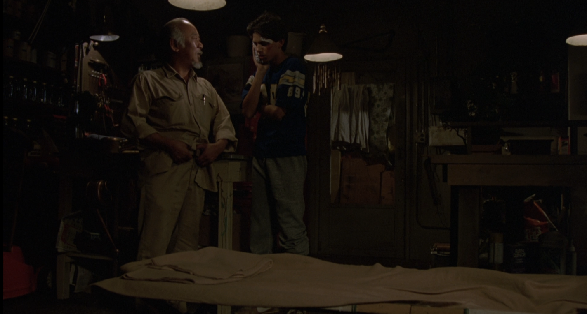

<blockquote class="pull">

We use canvas belt.

</blockquote>

<blockquote class="pull">

Karate is in your brain and heart. Not your belt.

</blockquote>

## Titles don’t tell anything.

Mr. Miyagi saves Daniel from the skeletors of *Cobra Kai*. Astonished how an old, tiny man can beat up so many young and strong Karate students, Daniel asks what belt Miyagi wears. But Mr. Miyagi is a true Karate master. Having learnt from his father, he has no so-called “formal” Karate education, and doesn’t have any Karate belts.

Unfortunately, [the tech world is not a pure meritocracy](http://www.wired.com/2013/11/silicon-valley-isnt-a-meritocracy-and-the-cult-of-the-entrepreneur-holds-people-back/). Marketing has a big say on who gets the job or who dictates others. But just like Karate, true code is not in titles. It is in your imagination and in your brain. It is not really important who has a higher title, or who yells the loudest. What only matters is who is smarter. If you use your wits to work around the powerful-but-lousy manager, you can still beat them at this game and get them do whatever *you* think is right.

Code is hardly subjective, and however dummy a tech manager is, good code can hardly be denied. Focus on your code and you will fly past the ranks. Ship more elaborate working code with a simpler approach, and you will get noticed. This brings us to the next lesson.

<blockquote class="pull">

The best way to earn respect is to fight good.

</blockquote>

Good code will bring you respect. This is true in most companies, and it is definitely true in the open source community. Write good code, provide maintainable, scalable solutions and you will instantly earn more respect (and karma) than any title could ever fetch you.

Although you may be thinking that you are under-valued at your current position and you are not getting enough respect from your peers, the open source community has a good understanding of skill and does a better job at discerning who would deserve respect.

Launch or contribute to an open source project, and you have a better chance of earning the respect you deserve. Don’t even think about holding back; there is enough seats for everyone.

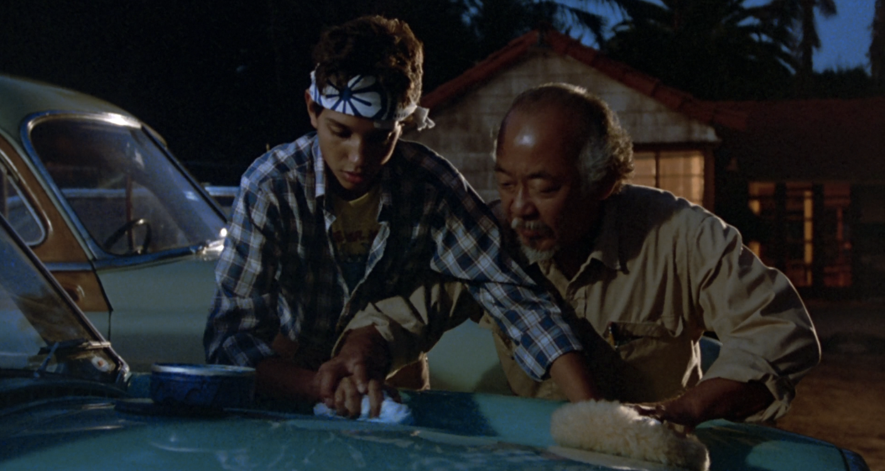

<blockquote class="pull">

Don’t ask, just learn.

</blockquote>

## You may not see the value at first.\
Keep calm and trust your master.

This is the iconic wax-on, wax-off scene where Mr. Miyagi has Daniel clean and polish all the cars he owns — and he has quite a few.

Mr. Miyagi and Daniel make a sacred pact before Miyagi agrees to teach. Mr. Miyagi promises to teach Daniel Karate, and Daniel promises to learn, without asking questions. Not asking questions is very crucial to learning as, generally, the path the master sees fit won’t be what the apprentice expects.

Mr. Miyagi makes Daniel polish his cars, sand the floor and paint his fences; all of which include key moves for Karate. But Daniel’s vision is far from understanding the motive, and he thinks Miyagi is just abusing his labor, instead of teaching him. In a rage, he demands to know what all those housework will be useful for; and Miyagi attacks him. Only then, can Daniel understand how those hard work translates into real use, after he is able to fend off all the attacks.

Apprentices should trust the training their master gives. They can’t conceive how a small thing they do today will be of use tomorrow, they are generally too inexperienced to understand the value. The education doesn’t even have to be strictly technical and related to what they do. In the end, software design takes its inspiration from life and things around us. Although the books offer hands-on techniques, masters can choose other ways to prove a point or to help the apprentice internalize the fundamental philosophy.

Take Object Oriented Programming for example. The very reason it exists is that the life we live is the result of a series of interactions between different objects, and it’s very easy and natural for humans to understand and build stuff in this way. We are a social species, and OOP is a social system of objects.

Often, when teaching OOP, I ask my apprentices to model the things around us, in life. It may be a hospital, a school or a company. What entities are there in the system? How do they interact? What is the best routine for that particular interaction? What are their responsibilities? You can teach SOLID principles over any real life system. You can teach event-driven architecture or even DDD. These things are successful in software engineering because they take inspiration from the very life that we live.

In the end, modelling a hospital is not real code. It is not, for example, an MVC structure. But since you have prior experience with hospitals in your life, it gives you a better taste of how a system should be designed. Later, when you see a software design, or the source code of a framework, you will do better at assessing that piece. If you know how to separate the responsibilities across entities, you can tell an architecture smell from a mile.

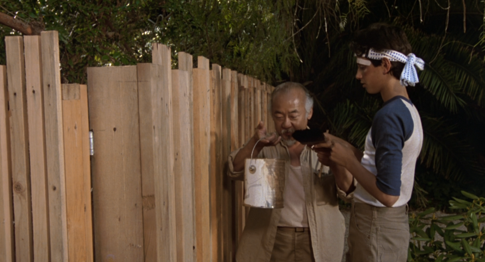

<blockquote class="pull">

Think outside the fence.

</blockquote>

## Double your vision.

As part of Daniel’s Karate training, Mr. Miyagi asks him to paint the fences of his house. Daniel works all day long and returns to his master, confident that he has finished the job. Miyagi asks if he has painted outside of the fence and Daniel gets extremely frustrated.

As an apprentice, it is only normal that your vision is limited, to inside the fence. But you have to keep in mind the possibility that there might be an outside face of the fence that you have to paint. You are probably mistaken if you think you can conceive the work you are assigned and its impacts in its entirety.

This is also one of the main reasons why we are very bad at estimation. We look at our surroundings, and make an estimation based on it, and it is almost always lacking the outer side of the fence. As the delivery time approaches, just like Daniel, we find out that we have to paint outside of the fence, too, and that is a very big effort that has to be spent in frustration. Industry professionals developed countless ways to combat this, one of them being agile project management. It is something like Mr. Miyagi coming in every five minutes to ask if you have checked outside of the fence to see if you have to paint there.

Another problem of being content with the inside of the fence is when an apprentice tries to learn. Apprentices think that they are far beyond in terms of knowledge and experience, and usher in to fill the gap. The quicker they learn, the better, right? But they usually end up learning only the boundaries, skipping the *boring*, architectural parts and avoiding the real understanding of why that particular solution works.

*“Good enough”* is not good enough when it comes to learning.

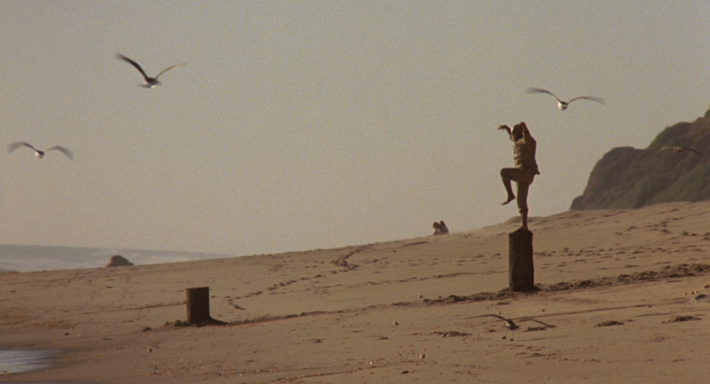

<blockquote class="pull">

You always want to learn cool tricks, but balance is more important.

</blockquote>

<blockquote class="pull">

Balance good, everything good.

</blockquote>

## First learn to stand.\
Then you can learn to fly.

Who wouldn’t remember the legendary crane kick technique, the kick that won the tournament for Daniel. Mr. Miyagi practices it on a stump often on the beach. When Daniel sees this cool thing, he immediately demands to know when he will learn it. But everything has a time and place, and Mr. Miyagi tells Daniel to learn how to stand on this feet first.

It is normal to want to learn the cool stuff, especially for apprentices. I am constantly showered with questions like how to learn cool 3D CSS animations, visual effects, tricks on AngularJS or how the coolest-ever Flux architecture fares. These are not a problem. It is not important to learn the cool stuff, what is important is to have very strong fundamentals. If you learn how to learn, it is only a matter of time before you get these cool techniques for yourself. Unfortunately, the new, shiny things are doing a great job in deceiving us and develop a fad to learn. But once that fad subsides, we give up learning all together.

It is important to keep your balance and ambitions in check; without giving in to fads, to keep going on track. If you try to fly before you even learn how to stand, you will almost always fall down during your initial steps before the take off. And it is only a matter of chance to lose your enthusiasm to try again.

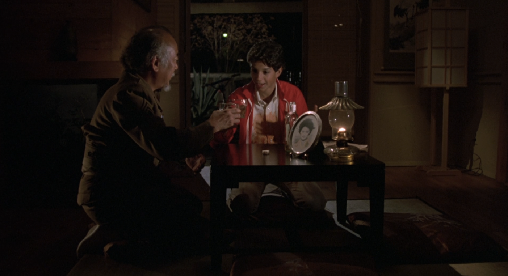

<blockquote class="pull">

Trust the quality of what you know, not the quantity.

</blockquote>

## Know less, know better.

Daniel, having only one master in his life, can’t contain himself when he thinks he might not be learning enough. He asks Mr. Miyagi if the things Daniel learn from him will be enough for the tournament.

It always happens. The apprentice, with their limited vision, questions the master’s ways of teaching and abilities, and if they are learning enough. The apprentice always wants to learn more stuff; the newest libraries, the newest languages, and lose their faith in their master if the master says no.

Take frontend development for instance. Almost everyday, a new library pops up, claiming to solve all the problems all the folks that came before failed to solve. Nobody has enough time to assess every one of these new technologies, let alone master them. So essentially, your best bet is to master what you know first. It is not really important if you know very little about a lot of stuff. It is important if you can deliver the best, without compromise, with what you know at hand. Are you using Ember as your choice of a frontend framework? Do you know it to its extent, are you able to modify the source code to suit your needs? Can you do whatever the job requires, without compromising quality, maintainability and principles? Stick to your guns, master your tools. There will always be new, shiny toys waiting for you after you are a master of your own arsenal.

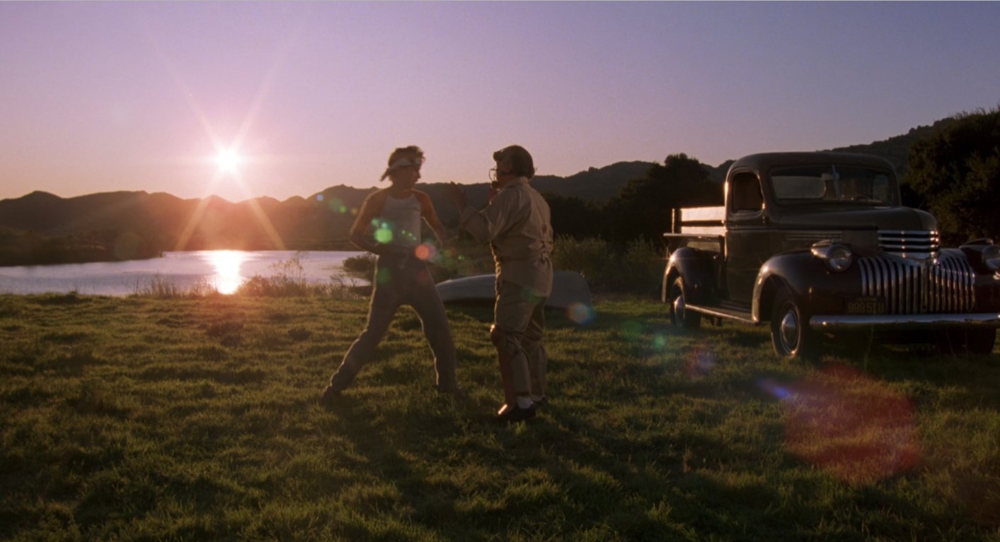

<blockquote class="pull">

I hate fighting.

</blockquote>

<blockquote class="pull">

There is always someone better than you.

</blockquote>

## Never take success for granted.

Mr. Miyagi fights flawlessly. He looks confident, never intimidated by the prospect of a challenge. Daniel admires his courage deeply. But to his astonishment, Mr. Miyagi says that he hates fighting. Not only that, but he is actually also afraid of fighting! He can never tell if his opponent will be better. True, he never faced an enemy better than himself, but that doesn’t mean the next one won’t break the loop.

I have been writing code since I was a child. When it comes to software, I know a thing or two. I have tackled [EEG signal processing](/academics/), published [a few](https://github.com/dashersw/pedalboard.js) [open source](https://github.com/dashersw/cote) [frameworks](https://github.com/tart/tartjs), implemented various distributed application architecture approaches in the enterprise. I look confident when it comes to a new challenge. I never failed in terms of code, I managed to overcome all the challenges I have faced. But I am always afraid. Afraid of failing the next time. Will I be able to write the next line safely? Will this challenge finally beat me? I am never certain of my abilities, and despite the years of experience, I am constantly striving to improve and sharpen my skills. It is, after all, the best way to minimize the risk of defeat at the next challenge.

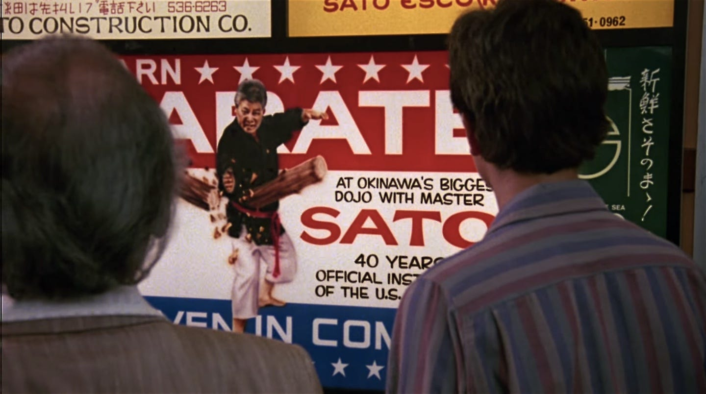

<blockquote class="pull">

— Can you break a log like that?

</blockquote>

<blockquote class="pull">

— Don’t know, never been attacked by tree.

</blockquote>

## Know what you know,\
know what you don’t know,\
and trust your fundamentals.

In the second movie, Mr. Miyagi and Daniel travel to Okinawa for the funeral of Mr. Miyagi’s father. Upon arrival, they see the poster of Miyagi’s biggest opponent Sato, *posing* as breaking a log with his hands. Daniel is awestruck at the show of strength and immediately wants to know if his master is capable of such a trick. Breaking a log with bare hands is the pinnacle of Karate, after all, right?

Miyagi responds indifferently, telling he was never attacked by a tree. Remember, Karate has to have a purpose. You would only break a log if you had to.

You will often hear questions about your experience with particular languages, frameworks or tools. True craftsmen don’t lie about their experience and are not afraid to say “no.” But this is hardly an issue, as in the end, these are only a means to the real objective, a solution to a problem. If the master has previous experience in that problem space (albeit with different tools), they can learn to use that specific tool or technology.

Later on in the movie, we see that Sato actually never broke any logs. But Miyagi has to, in order to save Sato’s life. Miyagi’s fundamentals are so strong that although it is the first time that he is faced with such a seemingly-impossible task (of breaking a huge log) he accomplishes it without a hitch. His past experience helps him defeat this challenge on his first attempt.

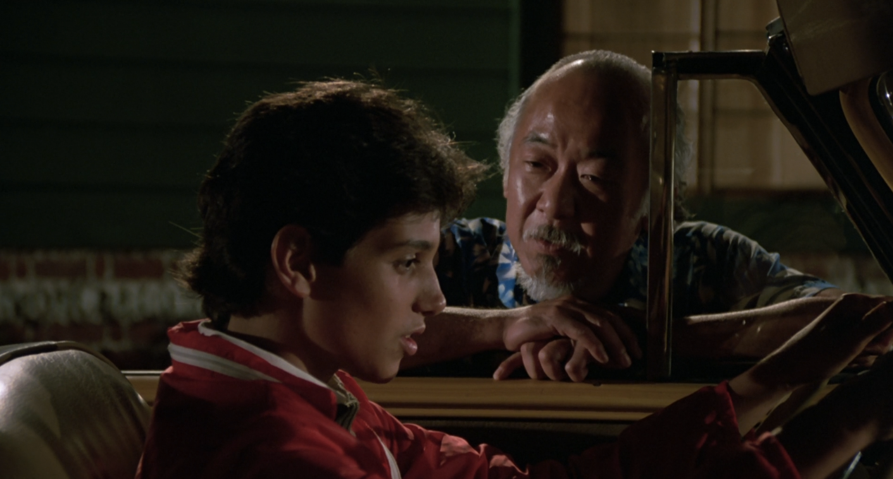

<blockquote class="pull">

A license never replaces your eye, ear and brain.

</blockquote>

## Certifications are gateways.\
Code is in your brain.

It turns out that neither Mr. Miyagi nor Daniel has a driving license. Daniel gets his license later on, and Mr. Miyagi lets Daniel choose a car out of his own collection as a gift. Mr. Miyagi’s first lesson for driving is that a license is only paperwork, and you have to be as alert as before to stay safe.

A lot of people throw money at countless certifications, fill up their LinkedIn profile with these and feel confident that they will secure a contract.

It is no wonder that all certificates, including diplomas, are shiny. They are labels. They are there to draw attention to an otherwise meaningless piece of paper. Labels are not an indication of the quality of ingredients. And don’t forget that some products with bad packaging may also turn out to be wonderful.

When you sit in front of the computer, all the certificates are left behind. Your code will talk. Your knowledge will talk. Trusting your certifications with contracts is the worst thing you can do to your career.

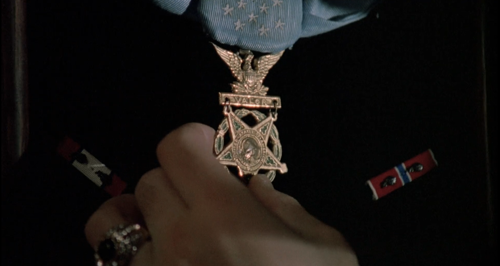

<blockquote class="pull">

Your heart tells if you are brave.\
A medal tells only if you are lucky.

</blockquote>

Mr. Miyagi is a war hero. He served in the U.S. army with 442nd regiment, which won the most number of medals in the history of the army. Mr. Miyagi has his medal hidden away in a box. Daniel crafts an attractive frame for the medal and gives it to Mr. Miyagi as a gift. Daniel thinks that Miyagi would be proud to show the medal off, as it signifies his bravery.

Miyagi tells him that a medal only tells that you were lucky enough to come back alive, to receive it. Only your heart tells if you are brave enough.

Let’s face it, our world is far from ideal. Equal opportunity is a myth. A diploma from a respectable university is cool, but it is not a testament to your engineering skills. You were just lucky enough to study at that university and finish it.

Code is in your brain.

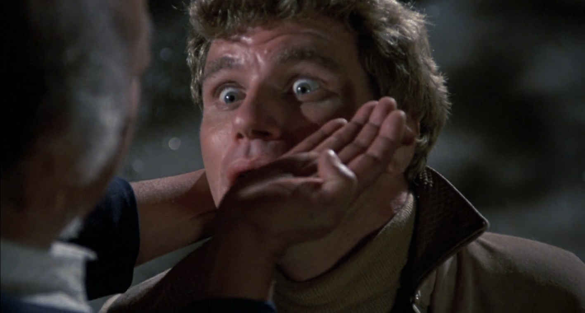

<blockquote class="pull">

*For a person with no forgiveness in the heart,\
living is a worse punishment than death.*

</blockquote>

## Be passionate.

Daniel enters the tournament and wins the title against the representative of *Cobra Kai* dojo. The sensei of *Cobra Kai* assaults his student after the tournament, beating him and breaking his award for the second place. Mr. Miyagi sees this incident and saves the boy, beating the sensei very badly. Mr. Miyagi raises his hand as to give the sensei one final death blow, and then…

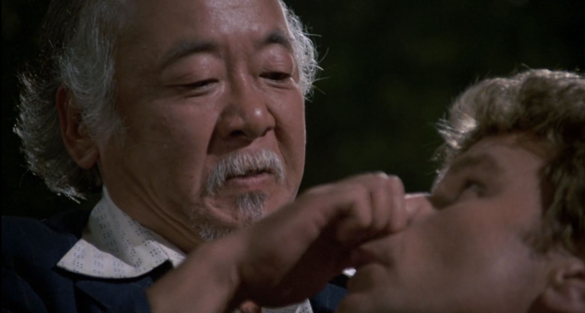

<blockquote class="pull">

For a person with no forgiveness in the heart,\
living is a worse punishment than death.

</blockquote>

…just honks his nose.

Daniel asks why he didn’t just kill the man — if you put aside the fact that no sane person would kill someone else over this and rot in prison for the rest of their life — and Miyagi says that living is a worse punishment for him. The sensei goes broke, losing everything he has.

Have you ever met a developer who was bored to death? Procrastinating all day long? They are the ones living with this punishment. I don’t know about the forgiveness in their hearts but I know, for sure, that they lack *passion*. Passion to learn, passion to improve, passion to deliver.

Software engineering can only make you happy when you are extremely passionate about it. If you lack enthusiasm, it will only be a punishment for you.

Mr. Miyagi has another quote for this:

<blockquote class="pull">

Either you Karate do yes, you Karate do no.\
You Karate do guess-so, \*squish\*! Just like grape.

</blockquote>

If you feel like you have a hard time focusing or you are squished like a grape and you think your miserable life will always be about mindlessly trashing the keyboard to put out meaningless code…

“You have to return to the roots,” says Mr. Miyagi. Life won’t happen without breathing. A breath gives you life. Close your eyes, take a few deep breaths. After a while, you will sense that whatever it is that clouds your mind will disperse. Of course, the dizziness is only due to the excessive oxygen that your brain receives, but let’s not ruin the moment.

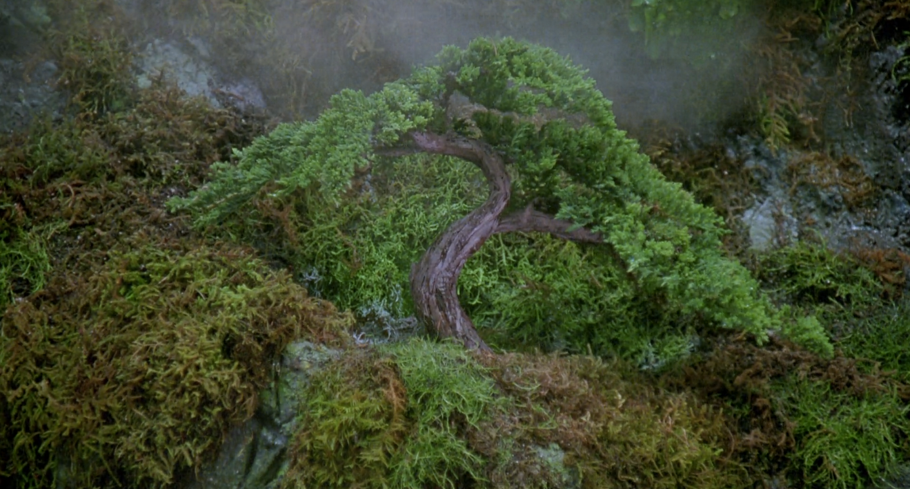

<blockquote class="pull">

If your roots are strong, you can grow no matter what.

</blockquote>

## Gain strong fundamentals.

I have talked a lot about strong roots. In the third movie Daniel breaks this gorgeous Bonsai tree, that Mr. Miyagi brought all the way from Okinawa, in half. But its roots are very strong and it recovers quickly.

If you have strong engineering roots, you can learn whatever is necessary to get the job done. You can change your skills and profile to adapt to the new trends. Today, being a full-stack developer is (again) popular and it is achieved via the MEAN stack. Yesterday it was via the LAMP stack. Yesterday, it was quite impossible to find a job without knowing at least a little bit of SQL, but today there are engineers who only work with MongoDB and know nothing else. While these shifts may look terrifying, their dread is inversely proportional to the strength of your fundamentals.

15 years ago I was making a living out of Visual Basic and static HTML web sites. 10 years ago, it was PHP. Then Ruby on Rails came along and I jumped on board. The advent of Node.js was terrific so I couldn’t resist. Now I am making my living out of JavaScript technologies. Although JavaScript doesn’t look like it will go away soon, I am confident that I can shape-shift if need be.

Trust your roots. They are the guarantors of your transition.

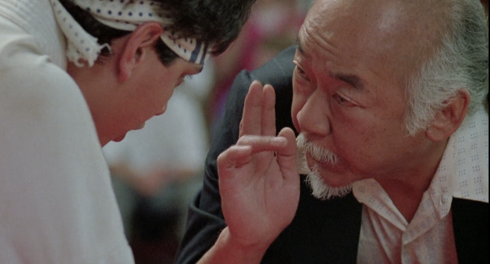

<blockquote class="pull">

Stay focused.\
Your best Karate is still inside you.

</blockquote>

<blockquote class="pull">

Now is the time to let it out.

</blockquote>

The trilogy ends with a dreadful fight where Daniel is fighting to defend his title. His opponent has beaten him up very badly and Daniel is literally trembling with fear. Mr. Miyagi helps Daniel regain his hold — and retain his title — with a magnificent lesson.

Never lose your focus, no matter what. Follow your life’s purpose to the end. Be a better learner tomorrow. Never succumb to fear. Never surrender.

Just…

<blockquote class="pull">

Stay focused.\
Your best code is still inside you.

</blockquote>

<blockquote class="pull">

Now is the time to let it out.

</blockquote>
