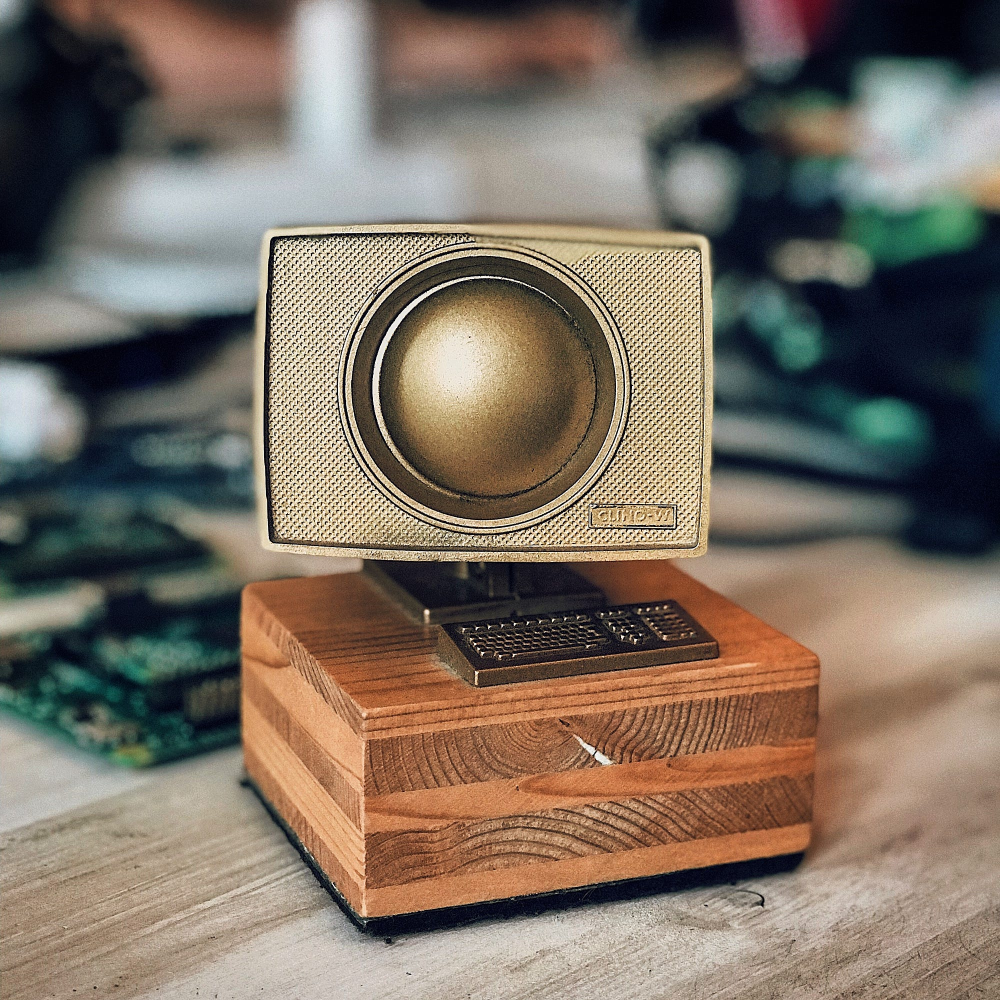
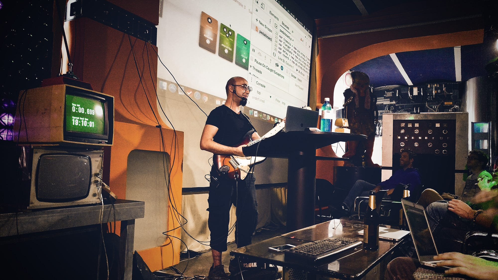
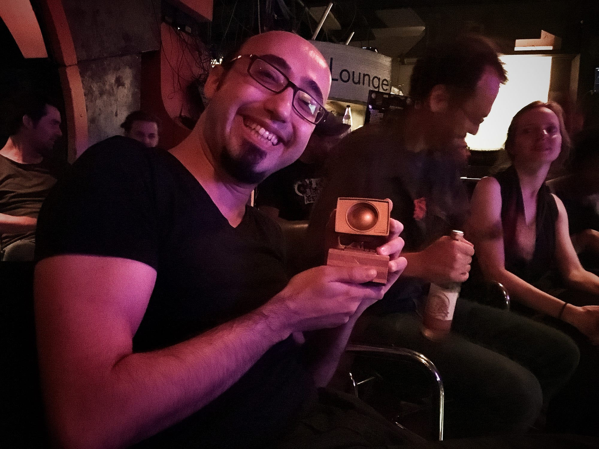
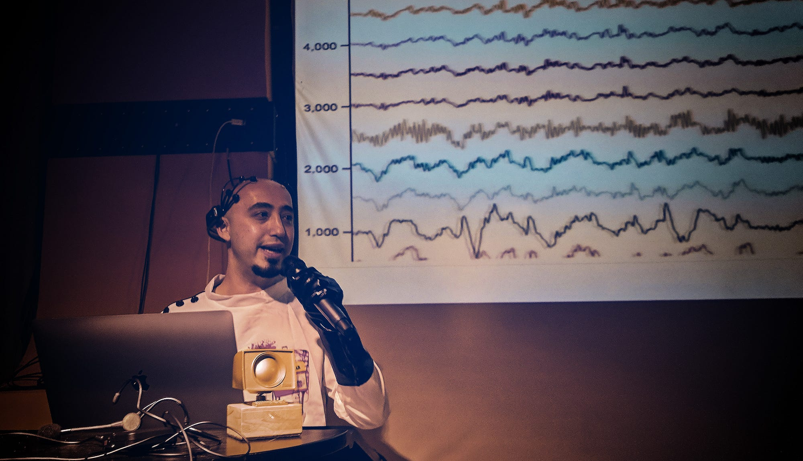
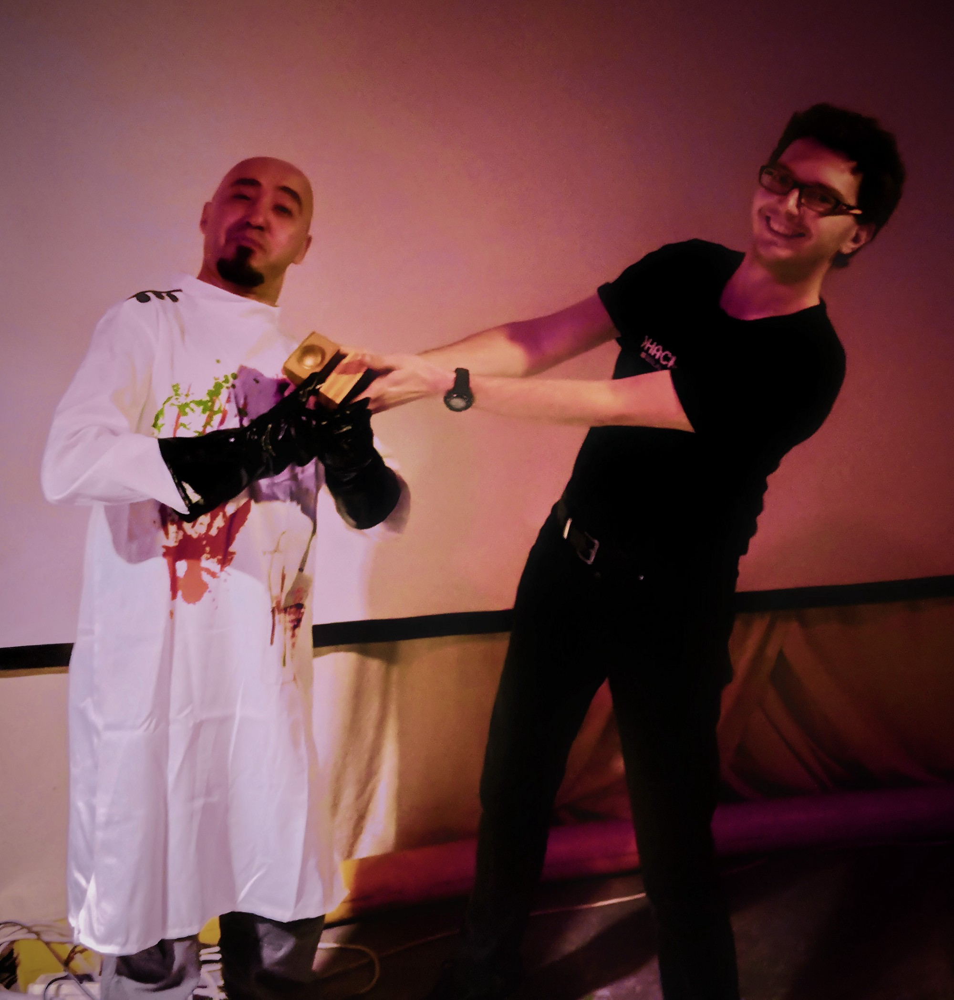

<figure>

<figcaption>

No it’s not the “hack” hack, the image was just very cool. [Source](http://www.desktopimages.org/wallpaper/219273/hacker-hack-hacking-internet-computer-anarchy-sadic-virus-dark-anonymous-code-binary)

</figcaption>
</figure>

I love coding. I open-sourced my first library back in 1999 for Visual Basic, and since then I never stopped coding. I always challenged myself to learn and to do more, and in the last 20 years, I had the opportunity to tackle a wide variety of challenges.

Since we as software engineers are not exactly the most social species out there, it’s often nice to get a chance to show off our work to each other, and hackathons or competitions are great ways to do that. This is why I was very excited when a friend invited me to [Berlin Hack & Tell](http://berlinhackandtell.rocks), a wonderful meetup for hackers that take place at the unworldly [c-base Raumstation](https://c-base.org).

On the last Tuesday night of every month, hackers from town (and often, abroad) come together to present their latest hacks, [since 2011](http://berlinhackandtell.rocks/2011-06-07-no1-the-first-berlin-hack-and-tell). Usually, hacks are projects that make use of common technology in an intelligent new way. Hybrid hacks that touch software and hardware, pure software hacks in the browser, and everything else in between is a good candidate. Every month, 8 hackers demo their projects for 5 minutes each and at the end the audience votes on their favorite hack. The winner project is called the ***Hack of the Month*** and the author gets to keep a lovely trophy for a month, until the next event when they hand it over to the new winner. It’s like the FIFA World Cup that changes hands every 4 years.

<figure>

<figcaption>

The lovely trophy. My precious.

</figcaption>
</figure>

So, this was something I couldn’t miss — you present before great hackers, and if you win, you get a trophy! What better way to showcase your skills, and affirm that you are good? By the way, did I tell you that I’m suffering from [Impostor Syndrome](https://en.wikipedia.org/wiki/Impostor_syndrome)? These are my attempts to overcome that. So bear with me.

## First win, pedalboard.js

[Berlin Hack & Tell #54 — itshappening.gif](http://berlinhackandtell.rocks/2017-07-25-no54-itshappeninggif) July 25, 2017

[My GitHub account](https://github.com/dashersw) is almost a cemetery for cool ideas which never gained proper attention. So it didn’t take much effort to find the project that I wanted to present; [pedalboard.js, the first WebAudio framework for guitar effects](http://github.com/dashersw/pedalboard.js). I always took pride in it, and although it has some stars on GitHub, I still believed that it deserved more. I was very, very excited when I finally got it up and running again, 5 years after its inception. I got my guitar, thought about some ways to present code and music in the limited time available for the demo, and went to c-base with a pounding heart.

There were other cool hacks that month but pedalboard.js, which brings together software and hardware to create music in a browser, was chosen as the Hack of the Month. I kind of knew I would win — mostly because I tend to dodge competitions I won’t be able to win — but it was still exhilarating. I learnt that I would receive a trophy at that moment, and it instantly became a more meaningful experience for me. I was euphoric.

<figure>

<figcaption>

Me rocking on the stage using a web browser as a pedalboard. How cool is that?

</figcaption>
</figure>

I also learnt that I had to take the trophy back the next month! 😱 Although it doesn’t mean that my Hack of the Month title would also be taken away, it still felt very temporary. If I wanted to keep it, I would have to keep winning it 😰That was when I decided to try to win it 3 times in a row, much like the the FIFA World Cup where countries who win it 3 times got to keep it forever. I thought, maybe if I win it enough times, they will just give it to me. And besides, it would be super cool :)

Here’s the repository to the source code for pedalboard.js:

<a class="linkcard" href="https://github.com/dashersw/pedalboard.js"><strong>dashersw/pedalboard.js</strong>pedalboard.js - Open source JavaScript framework for developing audio effects for guitars using the Web Audio API.<em>github.com</em></a>

## Second win, MIDI experiments

[Berlin Hack & Tell #55 — Post Eclipse Hacking](http://berlinhackandtell.rocks/2017-08-29-no55-post-eclipse-hacking) August 29, 2017

So, after deciding to win it for the second time, I immediately started looking for suitable projects. I have always followed a multidisciplinary approach in my life, and my first project was no exception. I wanted to continue on that tradition, therefore I looked for projects that somehow fused different experiences together. I was also sure that I wanted to show my love for JavaScript — any project I would do would be in JavaScript. I kind of take it as a personal mission to prove that JavaScript is actually infinitely capable.

The first project I had in mind was a swarm of autonomous robots. I wanted to find a microcontroller that allows running JavaScript and that can be mounted on a tiny robot with wheels. The idea is, the tiny robots actually communicate together or to a central computer to define the course of action and execute it as a group. A quick investigation showed that it would be a tough challenge — or even an expensive one.

The next idea I had was to design a motion controller that allows input for innovative applications like editing work on a PC. Wearables that translate your arm/hand movements into actions on your computer. I looked for 9-axis gyros and motion sensors that also have built-in BLE, because I wanted to show off the BLE capabilities of the browser. Again a quick search returned either too expensive gear to get started with, or results that would require tremendous effort to implement.

So I reviewed my position. I had previously demoed WebAudio API, and I was quite sure that I wanted to demo another web API. There was actually one particular web API that I had avoided for a long time mostly because I thought it was too complicated: [Web MIDI API](https://www.w3.org/TR/webmidi/). Now, MIDI is mostly known as a standard communication protocol for musical instruments, but it’s actually a very good tool for capturing any input (I would later learn that professional control equipment—e.g., video editing—also uses MIDI.)

I have always loved tactile input. Don’t get me wrong, I have no problems with touch interfaces, but tactile buttons and knobs are indispensable to me. Also as a photo-editing enthusiast, I always wanted to have a simpler, tactile control interface for photo-editing.

So I looked for MIDI input devices which would connect to my computer over USB and let me build several experiments with them. A DJ friend ran to my help and gave me two MIDI devices, a launchpad and another controller with faders and knobs. Below is an early demo of what I did with the launchpad:

<blockquote class="tweet">
I have long wanted to implement a Snake game. I wouldn't guess it would be so fun! #WebMIDI #Launchpad https://t.co/uo6RQlurUr
<a href="https://twitter.com/dashersw/status/901775548128645121">@dashersw on X</a></blockquote>

Using MIDI instruments for music is old-school. I prefer to play Snake on it, monitored real-time in the browser.

Although I had 5 minutes, I prepared 3 different demos. First I presented the launchpad as an oscillator using Web MIDI and Web Audio APIs, playing the theme of Game of Thrones. This was the only demo that stayed true to its intended use, though. The second one was the snake game, mirrored on the browser as well. Basically I used the launchpad as a low-res screen of 8-by-8 pixels; and the buttons would control the direction of the snake. Lastly, I demoed an online image editor making use of CSS filters and manipulating the image in the browser with knobs and faders. So, rotating a knob changes the brightness of an image, another one rotates the image, and another one resizes the image. I made use of several different CSS filters and actually came up with Instagram-style photo filters. I still think it’s a very cool idea to use tactile buttons and controls to manipulate images, instead of fiddling with a mouse or a touch pad.

In the end, this brought me the second win!

<figure>

<figcaption>

I was extremely happy to keep my trophy!

</figcaption>
</figure>

As the organizers told me, there have been one or two instances in the past of people winning the trophy two times; but it was extremely rare.

Again, here’s the repository to the source code:

<a class="linkcard" href="https://github.com/dashersw/midi-experiments"><strong>dashersw/midi-experiments</strong>Contribute to midi-experiments development by creating an account on GitHub.<em>github.com</em></a>

## Third win, typing with brain signals

[Berlin Hack & Tell #56 — Hackoween](http://berlinhackandtell.rocks/2017-10-31-no56-hackoween) October 31, 2017

Oh, the third time’s the charm. I had set the bar really high for myself this time: I not only wanted to win it a third time in a row, but I wanted to come up with the ultimate hack. A hack that I could never surpass, the peak of what I can deliver. Ironically, this took me way back to 2008. I had always believed that the most intriguing thing for humans was our brain, so I had decided to study EEG signals processing in a feeble attempt to decipher the brain. I had a [somewhat](/academics/) [successful](http://research.sabanciuniv.edu/15661/1/amcalar_ICPR10.pdf) [thesis](https://www.youtube.com/watch?v=0wUO9oVgOiY) on top of an established phenomenon letting people type with their brain signals. Right after graduation I had tried to transform this idea into a startup without much luck. I then went back to working as a software engineer, but I always blamed myself for leaving the field of neuroscience.

Since those early days it had been my goal to simplify this EEG project though, removing the need for expensive, research-grade EEG amplifiers and heavy software. I had started playing with a [wireless EEG electrode headset](https://www.emotiv.com) in late 2010, but professional life prevented me from fully chasing my dreams (pun intended). Still, this was my biggest achievement, and I thought it would be extremely challenging to replicate the same system with a wireless, consumer-grade EEG headset and a single programming language — none other than JavaScript itself! All in 30 days.

After about two weeks of intense work, this was the result:

<blockquote class="tweet">
HELLO. https://t.co/I4SEjsHpZL
<a href="https://twitter.com/dashersw/status/909559411693228038">@dashersw on X</a></blockquote>

I literally broke into tears after this video. I had basically rewritten everything that took me two years to implement in only 15 days. In a language people claim to be a toy. All the insane algorithms implemented in MATLAB and all the real-time UI in C# were rewritten in JavaScript, utilizing a consumer-grade headset that is arguably a little more than a toy. This was the moment when I realized I had blamed myself all these years for nothing — all these years weren’t spent in vain; I not only could still do EEG research, but I had improved my software skills so much that the end result wasn’t a tangled mess of horrible, unreadable code from hell but rather a very clean, extensible and maintainable piece of software. After crying for half an hour, I felt refreshed—almost like a new person.

I had about ten days to make this into a presentation for the Hack & Tell, so I hastily went on to wrap up the implementation. The event coincided with Halloween, and since there is always an expectation of entertainment from the presenters, I thought it would be extremely funny to attend the event with a Halloween costume—and especially, a mad scientist costume would make a lot of sense when I hit the stage with an EEG headset, presenting my brain signals on the display.

<figure>

<figcaption>

I always aspired to become a mad scientist. At least for a day I could imitate one. I also like how I look like a butcher.

</figcaption>
</figure>

And I made it again! I’m not sure though if I won the award because of the costume or the project 🤔 — as I was the only person who had a costume that night and some people were so entertained that they took pictures of me.

It was a prolific moment, and I was very proud and also amazed that I could do this. I had delivered my best, and I became the only person to ever win 3 trophies at the Hack & Tell.

Again, here’s the repository to the source code:

<a class="linkcard" href="https://github.com/dashersw/brain-bits"><strong>dashersw/brain-bits</strong>brain-bits - A P300 online spelling mechanism for Emotiv headsets. It's completely written in Node.js, and the GUI is…<em>github.com</em></a>

## The end

[Berlin Hack & Tell #57 — Off by one](http://berlinhackandtell.rocks/2018-01-30-no57-off-by-one) January 30, 2018

All good things must come to an end, they say, and this story was no exception. I had already decided to stop presenting, so I wouldn’t try my luck for the fourth time. I had to pay my respects to the trophy, look at it one last time, and hand it over to the next winner. I consciously left my computer at home to suppress any urge to present again, and I made it. Yesterday, on the last Tuesday of January 2018, I was sitting in the audience, applauding the next hacker for their Hack of the Month. It was a great honor to hand the trophy over at the end of the night, and I am ultimately grateful for this wonderful opportunity.

This last 6 months have been an amazing journey — I validated an old idea, learnt new APIs, challenged myself over and over again, and even went back to my roots to put an end to a decade-long internal struggle... Who says coding is a mechanical thing that is devoid of emotions? All of these happened thanks to a great team of hackers who got together in Berlin and decided to host monthly gatherings.

Coding is my attempt at changing the world. While I’m not quite there yet, at least I managed to change myself, and now you know how I did it.
