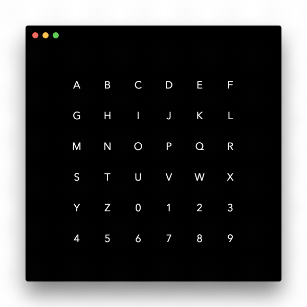

Find [brain-bits on GitHub](https://github.com/dashersw/brain-bits).

<a class="linkcard" href="https://github.com/dashersw/brain-bits"><strong>dashersw/brain-bits</strong>brain-bits - A P300 online spelling mechanism for Emotiv headsets. It's completely written in Node.js, and the GUI is…<em>github.com</em></a>

[brain-bits](https://github.com/dashersw/brain-bits) is a P300 online spelling mechanism for Emotiv headsets. It’s completely written in Node.js, and the GUI is based on Electron and Vue.

## History

I had a dream of re-writing my [Master’s thesis](/academics/) in a JavaScript-based stack, using commodity hardware like Emotiv. Back in 2008 when I first started, I was using a research-grade EEG amplifier from BioSemi, and MATLAB for data processing and C# for the GUI. It was a convoluted setup, and not very fun to work with. The stack helped me build and publish the world’s fastest academic P300 speller back in 2010, and since then I always wanted to make it lighter. Lighter in terms of code, technology, equipment and budget. I also thought about open-sourcing it, but the code would mostly be worthless to anyone else.

In 2010, I saw Emotiv launching and I was one of the first customers to get their headset. I immediately tried to record some data with Emotiv and test my previous work by replacing BioSemi with Emotiv in the stack. As expected, the results were not great, but promising. Due to other aspects of life gaining more weight, I stopped working on the project…

## Rebirth

… until 2017. I met a great meetup group called [Berlin Hack & Tell](http://berlinhackandtell.rocks), which takes place every month at the awesome [c-base](https://c-base.org). Every month, hackers around town get together and 8 of them present their projects. In the end, there’s a vote to choose the *Hack of the Month*. The hacker with the most votes receive the trophy from the previous month’s winner.

This seemed so much fun, I couldn’t pass on it. I first won the award with pedalboard.js, and then with a special project for WebMIDI. I wanted to showcase how powerful JavaScript and the browser is, and how much we can do with it. Having the trophy felt great, so I wanted to keep it, for a third time. Therefore I looked for *the* ultimate hack. As humanity, we managed to go to the moon, but we still don’t know how the brain works — for me, this is the ultimate hack of our lives.

<figure>

<figcaption>

an alpha version of the app, demonstrating the odd-ball paradigm

</figcaption>
</figure>

## Technical details

As a challenge, I rebuilt my P300 implementation piece by piece in JavaScript. I had to write C++ to interact with Emotiv, and translate a seemingly innocent, 30-line classifier from MATLAB to JavaScript, which took almost a week. After some weeks of very, very intense work, I ended up with [brain-bits](https://github.com/dashersw/brain-bits). A complete re-write and further improvements of my older project. I even used neural networks as a classifier.

The current stack is basically an [Electron](https://electronjs.org) app which runs Node on the backend and Vue.js on the front-end. I also make use of native modules for Node.js and [brain.js](https://github.com/BrainJS/brain.js) for the neural network and [d3](https://d3js.org) for drawing the EEG electrode monitor.

The result was astounding, and I won the *Hack of the Month* award for the third time. Open-sourcing it was further pride and joy, as this project had a very special place in my life.

See the project here on [GitHub](https://github.com/dashersw/brain-bits), and [say 👋](mailto:hello@arm.ag) if you would like to contribute. I would love to take this project forward, and finally enable real BCI use-cases.
