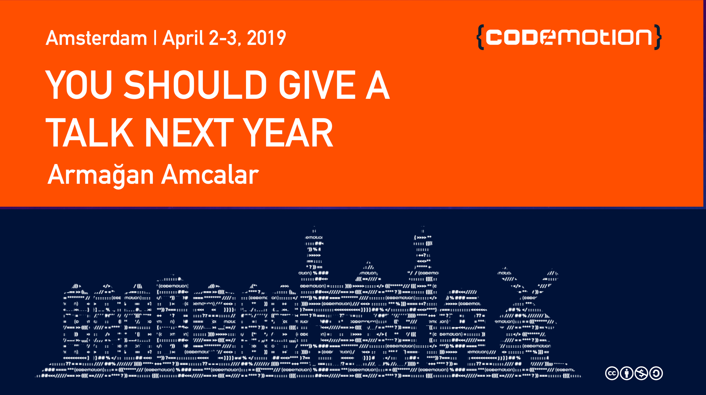

## You should give a talk next year

### Codemotion Amsterdam, April 2–3 2019

Participating in conferences and learning from experts is great, but as a community we are missing a lot when it’s the same faces every year, everywhere. We have to do our best to include everyone from a diverse background as speakers and learn from their experiences. This talk will prove you have what it takes to become a speaker yourself, and will give you practical advice to start your career as a speaker. We will talk about overcoming the impostor syndrome and eliminating self-doubt like “I don’t know what to talk about” and “I can’t talk in front of people”.

## Slides

<iframe src="https://www.slideshare.net/slideshow/embed_code/key/jyUcbCDGwa5kXl" title="You should give a talk next year" loading="lazy" allowfullscreen></iframe>

